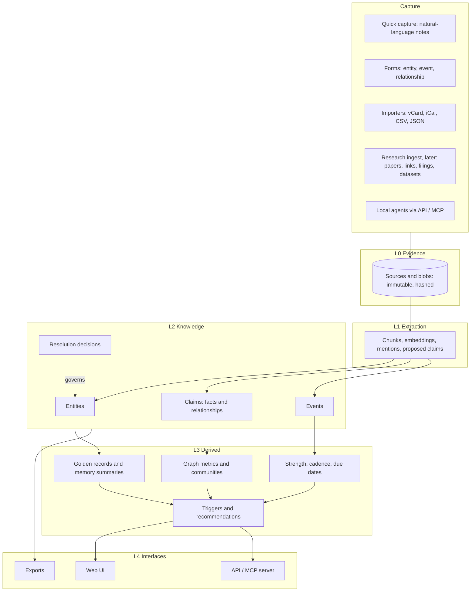
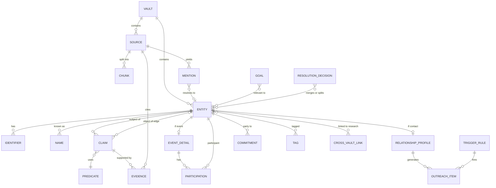

# Personal Graph & Entity Resolution: Conceptual Plan

**Status:** Draft v0.2 · 2026-11-09 (updated with your decisions: local only, single user, manual entry first, local AI, personal first)
**Scope:** Data model, entity resolution, relationship engine, semantic layer, research vault, a simple frontend, and a phased roadmap.

---

## 0. Summary of recommendations

1. **One engine, two vaults.** A *Personal* vault for relationship management and a *Research* vault for long-term investigation share the same code and schema. They live in **separate databases with separate encryption keys**. Data crosses between them only through explicit links that you confirm.
2. **Keep what was observed separate from what is believed.** Raw sources lead to *mentions*, and mentions are resolved into *entities*. A merge is a recorded decision you can undo, never a destructive rewrite. This is what lets entity resolution run over years and keep improving.
3. **Store facts as claims, not columns.** Every fact and every relationship is a statement: subject, predicate, object, plus its source, confidence, valid time and recorded time. This gives you provenance, contradictions, history, "what changed since we last spoke" and "as-of" queries without extra work.
4. **Relational core, graph as a projection.** Use SQLite as the system of record: one encrypted file per vault (SQLCipher), with FTS5 full-text search and the sqlite-vec vector extension. Run graph analytics in-process on projections built from it. Add a dedicated graph database only if traversal workloads ever need one.
5. **Events drive the CRM side.** Every interaction is an event. Days since contact, cadence, relationship strength, triggers and briefings are all computed from events.
6. **Local LLMs propose; you or a threshold decide.** Extraction from notes, resolution of ambiguous pairs and profile summaries all arrive as *proposed* claims with provenance. They go to a review inbox, or are auto-accepted above a confidence threshold you set per vault.
7. **Expose the system to local agents** through a localhost API and a local MCP server. Any outside model sees only abstracted, pseudonymized data that passes through the privacy gateway (section 12). This is where most of the "beyond human capacity" leverage comes from: pre-meeting briefs, watchlist monitoring, introduction matching and weekly reviews across hundreds or thousands of ties, which no person can sustain by hand.

### 0.1 Decisions made (2026-11-09)

| Question | Decision | What it changes in this plan |
|---|---|---|
| Local or hosted? | **Local only** | SQLite, one encrypted file per vault, a localhost-only app, no cloud sync in v1 (section 11) |
| Shared with collaborators? | **Not for now**, single user | No accounts or permissions. Provenance records only you, an importer, a rule or a model. |
| Data sources | **Manual entry per entity first**; standardized importers for later connections | Data entry and resolving names at entry time come first. One importer contract is defined now so connectors can plug in later (section 4.10). |
| AI | **Local model by default**; outside models only see abstracted data | A local AI tier plus a privacy gateway for optional outside reasoning (section 12) |
| Priority | **Personal first** | The research vault moves to the last phase. The schema keeps the vault concept so research can be added without migration (section 13). |
| Hardware for local AI | **No specific hardware**; assume a typical current laptop | Any local runtime that offers an OpenAI-compatible endpoint can be plugged in. If no model is available, the app still works without AI (section 12.2). |
| App shell | **Browser tab** | No desktop wrapper. The app is served on localhost. |
| Input surfaces | **Not tied to one surface.** Mainly direct input in the app, or Obsidian-style templated Markdown notes. | Templates and the rules for reading them are specified, and the in-app forms use the same structure (section 4.11, Appendix C). |
| What to capture | **Post-meeting follow-ups; entity information (links, facts, related connections, inferences); relations across the network** | Post-meeting flow (section 4.12), inferences as a separate kind of fact (section 4.3), and a per-entity link library |
| Default contact intervals | **Confirmed** (14, 30, 60, 120 and 365 days by tier) | None |

---

## 1. Use cases and scope

| Track | Primary jobs | What success looks like |
|---|---|---|
| **Personal: relationship management** (primary) | Track people and organizations once entered. Log past and upcoming events with notes and tags. Map relationships and facts. Know days since contact and when outreach is due. | You never lose a fact someone told you. The "Today" list tells you who to contact and why. Before any meeting you get a one-screen brief. |
| **Research: network mapping and resolution** (secondary, can run standalone) | Ingest people, organizations, publications, links, filings and historical events. Resolve duplicates across sources over years. Search structured data, full text and meaning together. | A researcher can answer "who is connected to whom, according to which sources, as of when" and can defend every edge with a citation. |
| **Strategic** (spans both) | Goals, warm-introduction paths, bridging ties, matching asks to offers, watchlists. | The system surfaces opportunities a human would not notice across a network larger than the ~150 relationships a person can actively maintain. |

**Not in v1:** multi-user collaboration, cloud sync or hosting, live network connectors (importers read local files), scraping social networks, sending messages automatically. (Drafting messages is in scope; sending is not.)

---

## 2. Design principles

1. **Append-only evidence.** Sources are immutable and content-hashed. Everything else can be derived again from them.
2. **Provenance on everything.** Every claim records who or what asserted it (you, an import, a rule, a model and its version) and which source span supports it.
3. **Reversibility.** Merges, splits and claim acceptances are decision records. Undoing one replays from the decision log.
4. **Bitemporal time.** *Valid time* is when something was true in the world. *Recorded time* is when the system learned it. Dates carry a precision (day, month, year, decade or "circa").
5. **Uncertainty is first-class.** Claims have confidence. Contradicting claims sit side by side, flagged instead of overwritten. This matters most in the research vault.
6. **A type system that can grow.** Entity types and predicates live in registries, not hard-coded tables. Adding "Vessel" or "Grant" is a data change, not a migration.
7. **Explainable recommendations.** Every suggestion shows its reason ("94 days since contact; cadence 60; she changed jobs on Oct 3").
8. **Privacy by partition.** Vault boundaries and sensitivity labels on predicates. Nothing leaves the machine by default. An outside model sees only what the abstraction gateway lets through (section 12).

---

## 3. Architecture in layers



| Layer | Contents | Mutability |
|---|---|---|
| **L0 Evidence** | Notes, emails, calendar items, web snapshots, PDFs, import rows | Immutable (append only) |
| **L1 Extraction** | Text chunks, embeddings, mentions (references to entities found in a source), proposed claims | Regenerated when models change; versioned |
| **L2 Knowledge** | Entities, claims, events, resolution decisions | Append-only claims; decisions can be reversed |
| **L3 Derived** | Golden records, summaries, graph metrics, scores, queues | Recomputed freely |
| **L4 Interfaces** | UI, API, MCP server, exports | Read-mostly; writes go through L2 as proposals or decisions |

---

## 4. Data model

### 4.1 Core concepts

| Concept | What it is | Notes |
|---|---|---|
| **Vault** | An isolated store: `personal` or `research` (you can have several research vaults, one per project or case) | Separate encrypted file and key |
| **Source** | Any piece of evidence: note, email, meeting log, URL snapshot, paper, filing, import row, or "manual entry by me" | Content hash, capture time, publish time, reliability rating |
| **Chunk** | A passage of a source's text, with full-text index and embedding | Unit of semantic search |
| **Mention** | A reference to an entity inside a source ("J. Smith, Acme CFO" in note #812) | The unit of entity resolution |
| **Entity** | A resolved real-world thing: person, organization, place, event, document, topic, asset, and so on | Stable ID that is never reused; merged entities redirect |
| **Identifier** | A strong key: email, phone, ORCID, DOI, LEI, Wikidata QID, URL, social handle, company registration number | Normalized; drives deterministic matches |
| **Name** | Every name an entity has had: legal, nickname, former, transliterated, misspelling | Carries valid time |
| **Claim** | A statement: subject, predicate, object or value, plus qualifiers, time, confidence, status and evidence | Both facts *and* relationships are claims |
| **Predicate** | A registry entry defining a property or relationship type: its domain, range, cardinality, inverse, symmetry, whether it is temporal, and its sensitivity | Lets the type system grow |
| **Event** | An entity with time, place, participants with roles, channel, status (planned, occurred, cancelled, missed), notes and tags | Interactions are a kind of event |
| **Tag / Collection** | Namespaced labels (`context:college`, `topic:ai-policy`) and curated sets | Polymorphic: entities, events, sources, claims |
| **Goal** | Something you are pursuing, which entities and claims can be linked to | Drives strategic ranking |
| **Relationship profile** | Personal vault only: *your* relationship to a contact (tier, cadence, closeness, how you met, computed strength) | Centered on you as the ego |
| **Commitment** | An open loop: an ask, an offer or a promise between parties, with a due date | Extracted from notes or entered by hand |
| **Trigger rule / Outreach item** | Rules that create dated to-do items with reasons | Feeds the "Today" queue |
| **Resolution decision** | A merge, split, "not the same" or cross-vault link, with who decided, evidence and time | Can be replayed and undone |

### 4.2 Entity types and engagement levels

**Base types:** `Person`, `Organization`, `Place`, `Event`, `Document` (paper, article, filing, web page), `Topic`, `Asset` (domain, vehicle, property, account), plus types you add. Each type has a JSON Schema in the type registry for type-specific attributes. Types can inherit (`Interaction` is an `Event`; `Paper` is a `Document`).

**Engagement level** (personal vault) is what keeps the personal network dense without turning it into a cluttered address book:

| Level | Meaning | Gets a relationship profile and cadence? |
|---|---|---|
| `ego` | You | n/a |
| `contact` | Someone you actively maintain a relationship with | Yes |
| `acquaintance` | Someone you have met but do not actively track | Optional (no cadence) |
| `reference` | Known *of*: a company, a school, a friend's spouse you have not met, a public figure | No |

Reference nodes are what connect your contacts to each other. Two contacts who both list "Stanford 2012" or "Acme (2018–2021)" become linked through a shared node, so the graph gets denser and more useful without you entering every pairwise edge.

### 4.3 Claims: facts and relationships in one shape

A claim follows the Wikidata model of statement, qualifiers and references:

```
claim:
  subject:      entity(Sarah Chen)
  predicate:    employed_by
  object:       entity(Stripe)            # an edge; for an attribute use value: {...}
  qualifiers:   { title: "Head of Payments Partnerships", team: "Partnerships" }
  valid_from:   2021-03     (precision: month)
  valid_to:     2027-01     (precision: month, status: expected)
  confidence:   0.9
  status:       accepted    # proposed | accepted | rejected | disputed | superseded
  basis:        told        # observed | told | heard | public | inferred
  evidence:     [ source#812 span 120-188 ]
  asserted_by:  model:extractor@v3, confirmed by: me
  recorded_at:  2026-11-09T14:02Z
  superseded_by: null
```

- **Edges are claims whose object is an entity.** `knows`, `employed_by`, `parent_of`, `co_authored_with`, `funded_by`, `introduced_by`, `member_of`, `located_in`, `owns`, `cites`, and so on.
- **Attributes are claims whose object is a value** (birthday, title, city, interests, dietary preference).
- **The predicate registry defines behavior:** `parent_of` is the inverse of `child_of`; `knows` is symmetric; `birth_date` has single cardinality; `employed_by` is temporal and can hold many values; `health_condition` is labeled `sensitive`.
- **Corrections never overwrite.** A new claim supersedes the old one, and the old one keeps its recorded time. This is how "what changed since I last spoke to X" works: a diff of claims by recorded time.
- **Basis records how you know something**, which is separate from confidence:
  - `observed`: you saw it yourself;
  - `told`: the person told you;
  - `heard`: someone else told you;
  - `public`: it comes from a published source;
  - `inferred`: it is a conclusion, either yours or the system's.

**Inferences** are claims with basis `inferred`. They come from two places:
- **Your own inferences**, e.g. "probably open to advisory roles, because she asked about my board experience". These carry a confidence and a reason.
- **Rule-based inferences** made by the system and marked `asserted_by: rule:<id>`, for example:
  - two people who attended two or more small events together (8 people or fewer) are flagged `likely_knows`;
  - overlapping time at the same small organization or team suggests `likely_worked_with`;
  - the same school and year suggests `likely_knows`;
  - two people introduced to you by the same person are recorded as sharing that connector.

Inferences are always shown apart from facts: in their own section of the profile and as dashed edges in the graph. Each has two actions:
- **Confirm** turns it into a fact with basis `observed` or `told`.
- **Reject** stores a negative claim so the same inference is never suggested again.

This keeps the network dense without letting guesses pass as facts.

### 4.4 Events

```
event (an entity of type Event):
  kind:           meeting | call | message | email | meal | conference | life_event
                  | publication | transaction | incident | ...
  status:         planned | occurred | cancelled | missed
  start / end:    timestamp or fuzzy date (precision)
  location:       entity(Place) or a free-text value
  channel:        in_person | video | call | message | email | social
  initiated_by:   entity          # used for reciprocity
  counts_as_contact: bool          # e.g. false for "saw her at a 500-person conference"
  participants:   [ {entity, role: host | attendee | speaker | subject | mentioned} ]
  notes_md:       free text (also stored as a Source, so it is chunked, embedded and extracted)
  tags:           [ ... ]
  follow_ups:     [ commitment ... ]
```

Historical events (a 2014 board meeting, a 1998 merger) and future ones (next Thursday's dinner) use the same shape. Only `status` and the dates differ.

### 4.5 Time

- **Valid time:** `valid_from` and `valid_to` on claims; `start` and `end` on events.
- **Recorded time:** `recorded_at` and `superseded_at` on claims.
- **Precision:** `instant | day | month | quarter | year | decade | circa`, plus optional bounds (`earliest`, `latest`). This handles "early 2019" and "late 1990s" without inventing false precision.

Two kinds of query follow from this:
- *Valid time:* "Show Sarah's employers in 2019." "Show the board of Org X as it was in 2008."
- *Recorded time:* "What did I believe about Org X on 2025-03-01?" This matters for research audit trails and for "since we last spoke" diffs.

### 4.6 Provenance and reliability

- **Source reliability** (research vault) uses the Admiralty grading: source reliability **A–F** and information credibility **1–6**. A claim's effective confidence combines model or user confidence with source grade and corroboration (the number of independent sources).
- **Corroboration:** many evidence rows can attach to one claim. Independence is tracked so that ten articles all copying one wire story do not count as ten sources.
- **Snapshots:** web sources store a fetched copy (HTML or PDF), its hash, the capture time and an archive URL where available, so citations survive link rot.

### 4.7 Tags, collections and goals

- **Tags** use namespaces (`context:`, `topic:`, `project:`, `circle:`) and can nest. They apply to entities, events, sources and claims.
- **Collections** are curated sets (a "Climate investors" list, or a set of entities in a case).
- **Goals** ("raise a seed round by Q2", "move into AI policy", "finish book research") link to entities, tags and topics with a relevance weight. Recommendations rank higher when they advance an active goal.

### 4.8 The relationship layer (personal vault only)

```
relationship_profile (one per contact):
  tier:                inner | close | active | extended | wider     # Dunbar-style layers
  cadence_days:        explicit override, else the tier default, else a learned value
  closeness_self:      1-5 (your own rating)
  how_met:             event or free text
  introduced_by:       entity
  contexts:            [tags]                      # the number of contexts is "multiplexity"
  # derived (L3):
  last_contact_at, days_since_contact, next_due_at, strength, reciprocity, trend
```

### 4.9 Entity-relationship diagram



A SQL sketch is in [Appendix A](#appendix-a-schema-sketch-sqlite).

### 4.10 Data entry and the importer contract

Entering information by hand, one entity at a time, is the main way data gets in. That has two consequences.

**Resolve names as you type.** In any field that refers to an entity (participants, employer, "introduced by"), autocomplete shows existing entities with enough context to tell them apart: *Raj Mehta (Acme · NYC · last contact 12d)* versus *Raj Iyer (Denver · reference)*. Picking one links to it. Choosing "new" creates the entity and runs a quick duplicate check before saving. For a hand-entered personal vault this prevents most duplicates. The background resolution in section 5 catches the rest.

**Every manual entry is still a source.** Each save writes a `source` of kind `manual` with a timestamp, so provenance, "when did I learn this" and the "changed since last contact" diff all work for hand-entered data too.

**The importer contract.** Every future connector implements the same small interface, so adding one never touches the core:

```
importer:
  id, version
  accepts:      file type (vcf, ics, csv, json, ...)
  map(raw_file) → [ImportRecord]

ImportRecord:
  external_key   stable key from the origin (vCard UID, calendar UID, row hash), used for idempotency
  entity_type
  names[]        with kinds
  identifiers[]  scheme + value
  claims[]       predicate + value or entity reference + valid time
  events[]       with participants given by reference to other records or to identifiers
  raw            the original record, stored as a source
```

Every import runs through the same pipeline:

1. **Parse and map** the file into ImportRecords.
2. **Dry run:** match each record against existing entities, by identifiers first and then by the resolution engine.
3. **Diff preview:** new entities, matched entities with new facts, conflicts with what you entered by hand, and ambiguous matches.
4. **Approve:** everything is written as one `import_batch`, and the whole batch can be rolled back.
5. **Re-import safely:** running the same import again is idempotent (external key plus content hash). Only changes come through, as new claims that supersede the old ones. Imports never overwrite facts you entered by hand. Conflicts go to the review inbox.

**Formats to support first:**
- **Markdown folders** using the templates in section 4.11 (Obsidian-style). This is the main input path besides the app itself.
- **vCard** (`.vcf`) for contacts and **iCalendar** (`.ics`) for events.
- **CSV** with a saved column mapping.
- The system's own **JSON** interchange format, also used for backup and export.

Source-specific exports, such as a LinkedIn CSV, email metadata or a messaging export, then become thin mappers onto the same ImportRecord shape.

**Links on an entity.** Any URL attached to an entity (a profile page, a talk, an article about them, a shared document) is stored as a `source` of kind `web`, with your note on why it matters. The profile shows these as a link library. Because the app is local only, links are *not* fetched by default. If you turn fetching on for a link, the app saves a snapshot and its hash so the content survives link rot.

### 4.11 Markdown templates (Obsidian-style)

The in-app forms and the Markdown templates describe **the same structure**, so a person or meeting entered either way produces identical records. Full templates and the reading rules are in [Appendix C](#appendix-c-markdown-templates-and-parsing-rules). In short:

| Markdown element | Becomes |
|---|---|
| Frontmatter `type:` (person, org, meeting, event, place) | The kind of note: an entity or an event |
| Note title and `aliases:` | Display name and other names |
| Frontmatter keys (`employer`, `city`, `email`, `birthday`, ...) | Claims or identifiers, mapped through the predicate registry |
| `[[Wikilinks]]` | References to entities, resolved by title or alias |
| Inline fields `predicate:: value` (Dataview convention) | Claims. The subject is the note itself, unless the line starts with a `[[Wikilink]]`. |
| A trailing `{from: 2018, to: 2021, confidence: 0.6, basis: told}` | Valid time, confidence, basis and other qualifiers |
| An `## Inferences` section | Claims with basis `inferred` |
| Tasks `- [ ] ... 📅 2026-11-14` (Tasks-plugin convention) | Commitments with due dates. `[x]` marks one done. |
| Daily-note lines such as `- call:: [[Dev Patel]] ...` | Interaction events that count as contact |
| Free-text sections (Summary, Notes) | Sources for search, and optionally for extraction by the local model |

**Sync direction.** Notes flow into the graph only. The app never edits the body of your notes. Two options are off by default:
- writing a `gid:` into a note's frontmatter, so the link to its entity survives file renames;
- generating a read-only `_graph/` folder of Markdown profiles and a Today list that you can browse inside Obsidian.

When a line is removed from a note, the claim it produced is superseded on the next import, not deleted, so history is kept.

### 4.12 Post-meeting capture

Logging a meeting is the most important input, so it gets a dedicated flow. It opens in three ways:
- automatically the day after a planned event (the calendar-offset trigger in section 6.3);
- from the "Log" button on any profile;
- by saving a meeting note from the template.

| Section | Pre-filled with | Becomes |
|---|---|---|
| Attendees, date, channel, location | The planned event, if there was one | Event and participants. Updates last contact for each attendee. |
| Summary | Nothing (free text) | A source, searchable. The local model can propose claims from it. |
| Learned | Suggestions from open questions on the attendees' profiles | Claims, defaulting to basis `told` |
| Follow-ups: mine and theirs | Open loops still outstanding with these people | Commitments with due dates. They appear on the Today view. |
| People mentioned | Autocomplete as you type | New entities (`reference` or `acquaintance`) plus their relations |
| Links shared | Nothing | Link-library entries on the relevant entities |
| Inferences | Nothing | Claims with basis `inferred` |
| Next contact | The date due from the person's cadence | Overrides `next_due` for each attendee |

Saving shows a one-screen confirmation of everything that will be written, in the style of Appendix B, before anything is stored.

---

## 5. Entity resolution (ER)

ER is a long-running process, not a one-time cleanup. The model treats **mentions** as the atoms of evidence and **entities** as clusters of mentions. The clusters can be revised whenever new evidence arrives.

### 5.1 Pipeline

```
new source ──► extract mentions ──► normalize ──► block ──► score pairs ──► cluster ──► decide
                                                                 │                    │
                                                    deterministic rules         auto-accept ≥ t_hi
                                                    probabilistic model         review queue between
                                                    LLM adjudication            auto-reject ≤ t_lo
```

1. **Normalize.** Unicode folding and transliteration. Name parsing (given name, family name, suffixes, honorifics). Nickname tables (Bob = Robert). Phonetic keys (Double Metaphone). Phones in E.164 format. Lowercased email with Gmail dots and plus-tags handled. Canonical URLs. Organization suffix stripping (Inc, LLC, GmbH).
2. **Block.** Generate cheap candidate pairs so comparisons do not grow as n²: exact identifier hash, phonetic family name plus first initial, organization token sets, and approximate-nearest-neighbor search over mention embeddings.
3. **Score.**
   - *Deterministic:* a shared strong identifier (email, ORCID, LEI, DOI author slot, Wikidata QID) means a match unless a cannot-link rule says otherwise.
   - *Probabilistic:* a Fellegi–Sunter style model with per-field match weights (name similarity, date of birth, location, employer overlap, title). It learns weights from your past decisions. For research-scale batch linkage, **Splink** is a mature open-source implementation.
   - *Relational:* shared neighbors. Two "J. Smith" mentions that both co-authored with the same three people are probably one person. This is the main advantage of doing ER inside a graph.
   - *Contextual:* embedding similarity of the surrounding text.
   - *LLM adjudication:* for the uncertain middle band only. Present both profiles with their evidence and record the model's rationale in the decision.
4. **Cluster.** Connected components subject to **must-link** and **cannot-link** constraints. Correlation clustering at research scale. A single weak link must never chain two large clusters together; cap transitive merges and require cluster-level coherence.
5. **Decide.** Thresholds are set per vault. The personal vault is conservative: anything ambiguous goes to review, since there are few records and mistakes are embarrassing. The research vault auto-accepts at a higher threshold and keeps everything reviewable.

### 5.2 Decisions, merges and splits

- A **merge** marks the losing entity `merged_into = winner`. Its ID still resolves (a redirect), and all claims, mentions and edges remain attached to their original records. Views read them through the redirect.
- A **split** reassigns selected mentions and claims to a new entity. Because claims kept their evidence, nothing is lost.
- A **"not the same" decision** creates a persistent cannot-link, so the pair never comes back as a candidate.
- **Your decisions always override model decisions.** When the model is retrained or re-run it cannot undo them.
- Each decision stores the model version, features, score and rationale, which gives a full audit trail for research use.

### 5.3 Golden record (survivorship)

The profile you see is a **computed view**, not stored truth. For each predicate it applies survivorship rules: your manual entries win, then the most reliable source, then the most recent valid claim, then the most corroborated one. Single-valued predicates show the winner and a "2 other values" hint. Disputed values are shown as disputed.

### 5.4 Identity over time

Do **not** merge things that are related but distinct:
- Organizations that rename, merge, are acquired or spin off: use `renamed_to`, `acquired_by`, `successor_of` and `spun_out_of` edges, all with valid time.
- People change names, roles and places. Those are temporal claims on one entity, not new entities.
- Roles versus persons: "the CFO of Acme" is a role that different people held at different times. Model the role as a claim with valid time, so "who was CFO in 2017" can be answered.

### 5.5 Across vaults

The vaults never merge automatically. A **cross-vault link** connects a personal entity to a research entity (for example, a colleague you know personally who also appears in your research corpus). The link is proposed by matching identifiers or names and **confirmed by you**. Through the link, the personal profile can show *read-only* research facts. Personal data never flows into the research vault.

---

## 6. Relationship engine: contact tracking, cadence, triggers and recommendations

### 6.1 Core quantities

```
last_contact_at(c) = max(event.start) over events where
                       status = occurred AND counts_as_contact
                       AND ego ∈ participants AND c ∈ participants

days_since(c)      = today − last_contact_at(c)

cadence(c)         = explicit override
                   ?? tier default        (inner 14 · close 30 · active 60 · extended 120 · wider 365)
                   ?? learned cadence     (median gap between past contacts × 1.15)

next_due(c)        = last_contact_at(c) + cadence(c)
days_to_due(c)     = next_due(c) − today         (negative means overdue)

next_scheduled(c)  = min(event.start) over planned events with c
```

**Suppression:** if a planned event with that person falls before or near `next_due`, do not raise an outreach item. Show "covered by Dinner on Nov 20" instead.

**Drift detection:** if the learned cadence differs from the configured one by more than 50% for more than two cycles, suggest changing the tier ("You've effectively moved Sam from *close* to *extended*. Keep it that way, or reconnect?").

### 6.2 Relationship strength (explainable, not a black box)

```
interaction_score(c) = Σ_events  w_channel × 2^(−age_days / H)          H = 90 days
    w_channel: in_person 1.0 · video 0.8 · call 0.7 · message 0.3 · email 0.3 · social 0.05

strength(c) = 0.5 × norm(interaction_score)
            + 0.3 × closeness_self / 5
            + 0.1 × norm(multiplexity)            # number of distinct contexts
            + 0.1 × reciprocity_health            # 1 − |0.5 − share_initiated_by_them| × 2
```

These weights are starting points that you can tune. The UI should always show the breakdown. Flag one-sided relationships, where you initiate more than 80% of contact, or where they do.

### 6.3 Triggers

| Trigger family | Examples | Creates |
|---|---|---|
| **Cadence** | Overdue against cadence; dormant tie (more than 2× cadence) with high strategic value | Outreach item |
| **Calendar offset** | 3 days before a planned meeting, generate a brief. 1 day after, prompt to log notes and follow-ups. | Brief or log prompt |
| **Recurring dates** | Birthdays, work anniversaries, memorials, the anniversary of when you met | Outreach item with a suggested message |
| **Fact change** | A new job, move, publication, funding round or award, from your notes, imports or watchlist monitoring | "Congratulate or check in" item |
| **Commitments** | A promise is due (you said you would intro Sarah to Raj by Friday); an ask from them is still open | Task |
| **Graph** | A new mutual connection; two contacts whose asks and offers match; a contact who just joined an organization tied to an active goal | Intro suggestion |
| **Research watchlist** | A watched entity appears in a newly ingested source; a new co-author; a new filing | Alert in the research inbox |

Each rule is a row in `trigger_rule` (scope: global, tag or entity; kind; parameters; active). This makes rules editable data rather than code.

### 6.4 The "Today" ranking

```
priority = urgency × importance + explicit_boost

urgency     = clamp(days_since / cadence, 0, 3)        # surfaced from about 0.9
importance  = 0.4 × tier_weight + 0.3 × strength + 0.3 × goal_relevance
explicit_boost: due commitments, dated triggers, pre-meeting briefs
```

Every row shows **why** it is there and offers one action: *log contact*, *snooze* (with a reason), *draft message*, *schedule* or *dismiss*. Snoozes and dismissals feed back into learned cadence.

---

## 7. Semantic layer: notes and events at scale

Every note, event description, email body you choose to store, and research document passes through the same pipeline:

1. **Chunk** into passages of about 200–500 tokens, keeping speaker and section metadata.
2. **Index:** full-text search (SQLite FTS5 with BM25 ranking) plus an embedding from a local embedding model, stored in sqlite-vec. Store the embedding model ID with every vector so you can re-embed when you change models.
3. **Extract** with the local LLM into structured form: mentions, proposed claims, events, commitments, topics, sentiment and dates. Everything links back to the source span.
4. **Derive** analyses on demand or on a schedule:
   - Topic trends per person, circle or period ("what do I talk about with X", "how has Y's focus shifted").
   - Sentiment or energy trajectory per relationship. Use this carefully and show it only to you.
   - Expertise mapping, so "who in my network knows about grid-scale storage?" draws on topics from notes, claims and publications.
   - Clustering of events and themes across thousands of notes.
5. **Retrieval for questions:** hybrid search (keyword plus vector plus structured filters) combined with **graph expansion**. Retrieve the relevant subgraph (entities, claims, recent events) and the supporting chunks, then answer with citations to sources. This is often called GraphRAG.

Example queries the layer should support:
- "Contacts I haven't spoken to in 6+ months who know about grid storage and are in Denver."
- "Every time someone mentioned they were hiring in the last year."
- "Papers since 2020 that cite both A and B, and the institutions their authors share."

---

## 8. Research vault specifics

> **Deferred to the last phase** (personal comes first). It is kept here so the schema and resolution engine are built with it in mind.

The research vault runs the same engine with stricter provenance and features for scale.

- **Projects and cases** scope sources, entities and hypotheses. A vault can hold many projects, and entities are shared across projects within the vault.
- **Source library:** papers (DOI and author list), articles, filings, court records, datasets, archived web pages, interviews and your own field notes. Each has a reliability grade, a snapshot and a hash.
- **Bulk ingest connectors**, used where licensing permits: OpenAlex and Crossref (publications), ORCID (researchers), ROR (institutions), Wikidata (general entities), GLEIF and OpenCorporates (companies), SEC EDGAR and other registries (filings), plus CSV or JSON uploads with a column-mapping step.
- **External IDs as anchors:** ORCID, ROR, DOI, LEI, Wikidata QID and registry numbers are high-confidence identifiers for ER and allow later enrichment.
- **Interoperability:** align the type and predicate registry with the **Follow the Money (FtM)** schema used by investigative tools (OpenSanctions, Aleph) and with Wikidata properties, so data can move in and out. Exports: GraphML or GEXF (for Gephi), CSV, JSON-LD and FtM.
- **Analytic features:**
  - Timeline and **as-of** views: a time slider on the graph, and both kinds of time from section 4.5.
  - **Hypotheses:** an Analysis of Competing Hypotheses matrix that links evidence (claims and sources) to hypotheses as consistent, inconsistent or neutral.
  - Contradiction finder: claims that conflict on single-valued predicates or overlapping time.
  - Network analytics: centrality, communities, brokers (betweenness), shortest and k-shortest paths, ego networks, and co-occurrence networks built from mentions.
  - Watchlists: re-run ER and alerting when new sources mention watched entities.
- **Running standalone:** the research vault does not need a personal vault. Packaged alone, it is a general network-mapping and resolution tool for researchers.

---

## 9. Frontend

Keep it straightforward. These are eight views, built in priority order.

### 9.1 Today (home)

```
┌ Today ─────────────────────────────────────────────── Review inbox (7) ┐
│ DUE / OVERDUE                                                           │
│  ● Sarah Chen   · 41d since · cadence 30 · changed jobs (Oct)   [Log][Draft][Snooze] │
│  ● Dev Patel    · 130d · dormant, bridges you to climate investors     │
│ UPCOMING (14 days)                                                      │
│  Thu  Dinner w/ Raj & Mia              brief ready ▸                    │
│  Sat  Alex's birthday                  suggested note ▸                 │
│ OPEN LOOPS                                                              │
│  You → Sarah: intro to Raj (due Fri)                                    │
│ SINCE LAST WEEK                                                         │
│  3 fact changes in your network · 2 new mutual connections              │
└─────────────────────────────────────────────────────────────────────────┘
```

### 9.2 Entity profile

```
┌ Sarah Chen ─ contact · tier: close · cadence 30d ─ last: 41d ago ─ next: overdue 11d ┐
│ MEMORY (auto-summary, each line cited)                                      │
│  Partnerships lead at Stripe → joining a climate startup in Jan. Daughter   │
│  starting at U. Michigan in fall 2027. Interested in grid storage.          │
│ CHANGED SINCE LAST CONTACT: new role (Oct 3) · moved to Oakland             │
├ Facts ───────────────┬ Relationships ─────────────┬ Timeline ───────────────┤
│ employer, title, city │ mini ego-graph (1–2 hops) │ events, notes, changes │
│ (source and confidence │ knows Raj · ex-colleague  │ filter by tag or kind  │
│  on hover; history)    │ of Dev · introduced by Mia│                        │
├ Open loops ─ Links ─ Inferences (confirm / reject) ─ Tags ─ Goals ─────────┤
└─────────────────────────────────────────────────────────────────────────────┘
```

### 9.3 Remaining views

3. **Capture:** plain forms for entity, event and relationship, with autocomplete that resolves names as you type (section 4.10). Also a single text box ("Coffee with Sarah today, she's leaving Stripe...") that the local model parses into a preview of the event, claims and follow-ups for you to confirm.
4. **Timeline and calendar:** past and planned events, filterable by person, tag or kind.
5. **Graph explorer:** ego network or project graph, filtered by type, tag, tier and time slider. Color by community. Includes a path finder ("warm path to X") and side-panel details.
6. **Search:** one box combining keyword, semantic and structured filters, with facets.
7. **Review inbox:** merge candidates side by side with evidence, proposed claims from extraction, contradictions, and cross-vault link proposals. Keyboard-driven accept or reject.
8. **Research workspace:** projects, source library, entity tables (a spreadsheet-like grid), timeline, graph, hypotheses board and exports.

**Graph rendering:** Cytoscape.js for ego and small graphs (under about 5,000 elements). Sigma.js with graphology (WebGL) for large research graphs.

---

## 10. Strategic recommendations: going beyond human capacity

The constraint being lifted is the cognitive limit: roughly 150 maintained relationships, imperfect recall, and no capacity for continuous monitoring. The system should do the following.

1. **Perfect memory with context.** Every fact is recalled with its source, and the "changed since last contact" diff is computed automatically. Pre-meeting briefs combine recent events, open loops, new facts, shared connections and suggested topics.
2. **Maintain weak ties at scale.** Weak ties are where new information and opportunities come from (Granovetter). Light-touch cadences for the extended and wider tiers, with suggested low-effort touches (sharing an article that matches their topics, congratulations on a fact change), keep hundreds of ties warm.
3. **Find structural holes and brokerage.** Identify contacts who bridge otherwise separate clusters (Burt), and contacts whose introduction to each other would create value. Rank by goal relevance.
4. **Warm-introduction paths.** Weighted shortest paths where an edge's cost is `−log(strength)`, so the strongest chain wins. Show the top three paths with the person you would ask at each hop.
5. **Asks and offers matching.** Track what people need (hiring, raising, looking for a doctor, moving to Berlin) and what they offer (expertise, roles, introductions). Matching runs continuously and surfaces pairs.
6. **Reciprocity awareness.** A lightweight record of favors given and received, used only for your own balance and never exposed. It helps you notice one-sided relationships in either direction.
7. **Monitoring as an agent task** (optional, off by default because it needs network access). Agents watch public sources (publications, company news, filings) for watchlisted entities and *propose* claims, which you review in the inbox. Turn it on per watchlist. Outgoing queries contain only the public names you chose to watch, but a query still reveals your interest in that name.
8. **Weekly review ritual.** An agent compiles the week: who you saw, loops closed and opened, ties decaying, opportunities, and goal progress. It drafts the next week's outreach.
9. **Ask the network questions.** "Who could help with X?" is answered from topics, claims, publications and paths, not just from tags.
10. **Agent interface.** A local MCP server (stdio or localhost only) exposing tools such as `search`, `get_profile`, `log_event`, `propose_claim`, `due_outreach`, `find_paths`, `brief(entity)` and `research_query`. Agents can read but write **only proposals**, and every agent write is attributed and reversible.

---

## 11. Technology recommendations

Chosen for a local-only, single-user tool that should feel like an app, not a server to run.

| Concern | Recommendation | Why |
|---|---|---|
| System of record | **SQLite** with **SQLCipher** (encryption), **FTS5** (full-text) and **sqlite-vec** (vectors); recursive CTEs for graph queries | One encrypted file, no setup or administration. Backup means copying the file. Comfortably handles a personal network with hundreds of thousands of facts, notes and chunks. |
| Vault isolation | One file per vault, each with its own key | Clean privacy boundary. The research vault can later ship standalone. |
| Key handling | Passphrase-derived key, optionally cached in the OS keychain | Data cannot be read if the file is copied |
| Graph analytics | In-process **igraph** or **NetworkX** projections for centrality, communities and paths | No second database to keep in sync |
| Entity resolution | In-app incremental matching (`rapidfuzz` for string similarity, `jellyfish` for phonetic keys, nickname tables). **Splink** (on DuckDB, also local) later for research-scale batch jobs. | Fast checks at entry time; explainable batch linkage later |
| Backend | **Python + FastAPI** bound to `127.0.0.1` only, with an in-process background worker for extraction, scoring and triggers | Matches your existing Python work; nothing exposed to the network |
| Frontend | **React (Vite) or SvelteKit**, served on localhost and used in a **browser tab**. Cytoscape.js for graphs, vis-timeline for timelines. | Simple and well supported; no desktop wrapper needed |
| Local AI | **Model-agnostic.** The app talks to any **OpenAI-compatible endpoint** on localhost (Ollama, llama.cpp server, LM Studio and others all provide one). Configure one URL and model name for chat and one for embeddings. Use structured JSON output against schemas. | Not tied to any hardware or runtime; notes never leave the machine |
| Outside AI | Optional, off by default, only through the privacy gateway (section 12.3) | Lets a larger model help with strategy without seeing personal details |
| Analytics | DuckDB reading the SQLite file directly, for heavy semantic or statistical analysis | Fast local analysis at scale |
| Packaging | A single Python package launched locally (`pip install`, then one command). No Docker required. | Low friction for daily use |

**When to move to Postgres:** only if the research vault grows to millions of records or sharing is ever added. Keep the schema portable (plain types, JSON stored as text, no SQLite-only tricks in core tables) so a vault can be promoted.

---

## 12. Privacy, security and the local AI gateway

### 12.1 Baseline

- **Local only.** One SQLCipher-encrypted file per vault. The core app makes no network calls; importers read local files.
- **Backups** are encrypted file copies plus an optional JSON export, written to a location you choose, such as an external drive.
- **Sensitivity labels** on predicates (health, family, finances, politics, religion) control what is shown, what any model sees, and what can be exported.
- **Audit log:** an append-only record of every write, every agent read, and every outgoing request.
- **Deletion** is the one exception to append-only: crypto-shred the blobs and leave tombstones.
- **Third parties did not opt in.** Features like reciprocity and sentiment stay private to you and are never written into exports.

### 12.2 Local model tier (the default)

All AI tasks run locally by default: extraction from notes, embeddings, summaries, resolution of ambiguous duplicates, pre-meeting briefs and message drafts.

Small local models do well when tasks are designed for them:
- **The app assembles a short context.** It retrieves the relevant claims and note chunks and passes only those, instead of asking the model to read the whole vault.
- **Output is structured.** The model returns JSON against a schema (for example, a list of proposed claims with predicates from the registry), and the app validates it.
- **One narrow job per call:** extract, classify, summarize or compare.

**Hardware assumptions.** No specific hardware is assumed. The baseline is a typical current laptop running a quantized model in the 7–14B range. Larger local models drop in by changing the configured endpoint. If no model is available, the app degrades gracefully:
- forms, Markdown templates, search by keyword, reminders and rule-based inferences need no AI;
- only free-text extraction, summaries and meaning-based search are switched off.

Every task has a small fixed test set (sample notes with expected output), so you can check quality when you change models.
- **Model ID stored with every output**, so results can be re-run when you upgrade the model.

### 12.3 Outside reasoning through abstraction (optional, off by default)

Some tasks benefit from a larger outside model and do not need anyone's personal details: reasoning about network structure, introduction strategy, goal planning, or reviewing the patterns in your week. For these, the **privacy gateway** sends an abstracted version of the problem and translates the answer back locally.

1. **Task-scoped context.** The app decides what the task needs. For "who should I introduce to whom", that is the relevant subgraph's structure, tiers, topics and categories of asks and offers. It never sends the whole vault.
2. **Pseudonymize.** Each entity gets an alias for this request only (Person A, Org 3). The mapping stays in local memory and is discarded afterwards.
3. **Generalize.** Exact values become categories:
   - employer → industry and size ("large payments company");
   - city → region;
   - dates → relative ("about 3 months ago");
   - ages → bands;
   - job titles → seniority level.
4. **Drop.** Free-text notes, identifiers (emails, phones, handles) and sensitive predicates never leave.
5. **Check.** A local rule pass, optionally backed by the local model, scans the outgoing payload for names, contact details and rare values, and blocks the request if it finds any. A uniqueness check catches combinations that could identify someone even after generalizing (for example, "the only climate-tech founder in a small city"); it generalizes further or drops the attribute.
6. **Preview and log.** You see the exact payload before it is sent. Later you can auto-approve trusted task types. Every request is recorded in the audit log.
7. **Re-identify locally.** The answer refers to aliases. The app maps them back to real entities and writes the results as *proposals* for your review.

Example of what actually leaves the machine:

```json
{
  "task": "suggest_introductions",
  "goal": "move into climate investing",
  "people": [
    {"id": "A", "tier": "close",    "sector": "fintech, large", "topics": ["payments", "climate"], "seeking": ["climate-tech roles"]},
    {"id": "B", "tier": "extended", "sector": "venture capital", "topics": ["energy storage"],      "offering": ["intros to climate founders"]},
    {"id": "C", "tier": "active",   "sector": "climate startup, early stage", "seeking": ["partnerships lead"]}
  ],
  "edges": [{"a": "A", "b": "B", "strength": 0.2}, {"a": "me", "b": "A", "strength": 0.8}, {"a": "me", "b": "B", "strength": 0.4}]
}
```

**Caveat:** abstraction lowers risk but is not guaranteed anonymity. Network structure combined with categories can sometimes identify people. Keep outside reasoning opt-in for each task type and send the minimum.

**Task routing:**

| Task | Default | Can use outside model? |
|---|---|---|
| Extraction from notes | Local | No (free text) |
| Embeddings and search | Local | No |
| Profile summaries, briefs | Local | No |
| Resolving ambiguous duplicates | Local | No (needs names and identifiers) |
| Message drafting | Local | Only generic templates with no personal details |
| Network strategy (brokerage, intro planning, paths toward goals) | Local | Yes, abstracted |
| Weekly review analysis | Local | Yes, as abstracted aggregates |
| Research on public entities (later phase) | Local | Yes, since public data is not personal; links to the personal vault are always stripped |

---

## 13. Roadmap (personal first)

| Phase | Deliverable | Contents |
|---|---|---|
| **0: Foundation** | Personal MVP you use daily | Encrypted SQLite vault; schema (sources, entities, identifiers, names, claims, events, participation, tags, relationship profiles); forms for entities, events and relationships with resolve-as-you-type autocomplete; profile page; Today view with days since contact, cadence and next due; timeline; JSON export and backup |
| **1: Capture and memory** | Notes become structure | Post-meeting flow (section 4.12); Markdown templates and folder import, read by fixed rules with no AI needed (Appendix C); commitments (open loops); per-entity link library; inferences with confirm and reject; rule-based inferences; review inbox; quick-capture box parsed by the local model into proposed claims; FTS5 and local embeddings; hybrid search; "memory" summaries; "changed since last contact" |
| **2: Importers, resolution and triggers** | Data from elsewhere, kept clean | Importer contract with vCard, iCal, CSV and JSON importers, dry-run diff and batch rollback; background duplicate resolution (merge, split, not-the-same, undo); trigger engine (recurring dates, calendar offsets, fact changes, commitments); pre-meeting briefs; graph explorer |
| **3: Strategic** | Leverage beyond human capacity | Goals; warm-introduction paths; brokerage and introduction suggestions; asks and offers matching; weekly review; local MCP server; privacy gateway for optional outside reasoning |
| **4: Research vault** | Standalone research tool | Projects; source library with snapshots and reliability grades; bulk importers (OpenAlex, ORCID, Wikidata and others); Splink batch resolution; as-of queries; contradictions; hypotheses matrix; FtM, GraphML and CSV export; large-graph view (Sigma.js) |

**Suggested first build slice:** Phase 0 alone. It gets the daily loop working with no AI at all: enter people, log interactions, and see who is due. Every later layer then has real data to work on.

---

## 14. Remaining questions

All earlier questions are answered (section 0.1). Three small ones remain, and none blocks Phase 0:

1. **Obsidian plugins.** Do you already use Dataview and Tasks? The templates follow their conventions (`key:: value` fields and `📅` due dates), so they render in Obsidian with no changes. If you use other conventions, the parser's key map can be adjusted.
2. **Optional write-backs.** Do you want either of the opt-in features from section 4.11: a `gid` written into note frontmatter so links survive renames, or a generated read-only `_graph/` folder of profiles inside your notes vault?
3. **Inference rules.** Which rule-based inferences from section 4.3 should be on by default? Shared small events, overlapping time at an organization, the same school and year, a shared connector, or all of them?

---

## Appendix A: Schema sketch (SQLite)

Illustrative only. Names and types will change during implementation.

- IDs are text (UUIDv7 or ULID, so they sort by creation time).
- JSON is stored as text and queried with SQLite's JSON functions.
- Dates are ISO-8601 text.
- Booleans are integers.
- Run with `PRAGMA foreign_keys = ON` and WAL journal mode.

```sql
-- ── Registries ─────────────────────────────────────────────────────────────
create table entity_type (
  id          text primary key,              -- 'person', 'organization', 'event', ...
  parent_id   text references entity_type(id),
  attr_schema text not null default '{}'     -- JSON Schema for type-specific attributes
);

create table predicate (
  id           text primary key,             -- 'employed_by', 'birth_date', 'knows', ...
  label        text not null,
  domain_types text not null,                -- JSON array of allowed subject types
  range_kind   text not null,                -- 'entity' | 'string' | 'date' | 'number' | 'json'
  range_types  text,                         -- JSON array of object types when range_kind = 'entity'
  cardinality  text not null default 'many', -- 'one' | 'many'
  temporal     integer not null default 1,
  symmetric    integer not null default 0,
  inverse_id   text references predicate(id),
  sensitivity  text not null default 'normal' -- 'normal' | 'sensitive' | 'restricted'
);

-- ── Evidence (L0/L1) ───────────────────────────────────────────────────────
create table import_batch (
  id          text primary key,
  importer    text not null,                 -- 'vcard@1', 'ical@1', 'csv:<mapping>@1', ...
  file_name   text,
  file_hash   text,
  started_at  text not null default (datetime('now')),
  status      text not null default 'preview', -- preview | applied | rolled_back
  stats       text not null default '{}'
);

create table source (
  id            text primary key,
  kind          text not null,               -- manual | markdown | note | calendar | import | web | paper | ...
  import_batch_id text references import_batch(id),
  external_key  text,                        -- for idempotent re-import
  uri           text,
  title         text,
  content       text,                        -- raw text (notes, rows); large blobs stored beside the file
  content_hash  text not null,
  captured_at   text not null default (datetime('now')),
  published_at  text,
  reliability   text,                        -- Admiralty A–F (research)
  credibility   integer,                     -- Admiralty 1–6 (research)
  metadata      text not null default '{}'
);
create unique index source_external on source(kind, external_key) where external_key is not null;

create table chunk (
  id        text primary key,
  source_id text not null references source(id),
  ordinal   integer not null,
  text      text not null
);
create virtual table chunk_fts using fts5(text, content='chunk', content_rowid='rowid');
create virtual table chunk_vec using vec0(chunk_rowid integer primary key, embedding float[1024]);
create table embedding_meta (target text primary key, model text not null, dims integer not null);

create table mention (
  id         text primary key,
  source_id  text not null references source(id),
  chunk_id   text references chunk(id),
  span_start integer, span_end integer,
  surface    text not null,
  type_guess text references entity_type(id),
  features   text not null default '{}',     -- normalized name parts, phonetic keys, context
  entity_id  text references entity(id),     -- current resolution (nullable)
  resolution_score real
);

-- ── Knowledge (L2) ─────────────────────────────────────────────────────────
create table entity (
  id           text primary key,
  type_id      text not null references entity_type(id),
  display_name text not null,
  status       text not null default 'active', -- active | merged | archived | deleted
  merged_into  text references entity(id),
  engagement   text,                           -- ego | contact | acquaintance | reference
  attrs        text not null default '{}',
  created_at   text not null default (datetime('now'))
);
create virtual table entity_name_fts using fts5(name, entity_id unindexed); -- autocomplete at entry

create table identifier (
  entity_id text not null references entity(id),
  scheme    text not null,                   -- email | phone | orcid | doi | lei | wikidata | url | handle
  value     text not null,                   -- normalized
  verified  integer not null default 0,
  source_id text references source(id),
  primary key (scheme, value, entity_id)
);

create table entity_name (
  entity_id  text not null references entity(id),
  name       text not null,
  kind       text not null default 'primary', -- primary | legal | nickname | former | transliteration
  valid_from text, valid_to text
);

create table claim (
  id             text primary key,
  subject_id     text not null references entity(id),
  predicate_id   text not null references predicate(id),
  object_id      text references entity(id),  -- set for edges
  value          text,                        -- JSON, set for attributes
  qualifiers     text not null default '{}',
  valid_from     text, valid_to text,
  time_precision text,                        -- day | month | year | decade | circa
  confidence     real not null default 1.0,
  status         text not null default 'proposed', -- proposed | accepted | rejected | disputed | superseded
  basis          text not null default 'observed', -- observed | told | heard | public | inferred
  asserted_by    text not null,               -- 'user' | 'import:<batch>' | 'rule:<id>' | 'model:<id>@<ver>'
  recorded_at    text not null default (datetime('now')),
  superseded_by  text references claim(id),
  check ((object_id is null) <> (value is null))
);
create index claim_subject on claim(subject_id, predicate_id, status);
create index claim_object  on claim(object_id) where object_id is not null;

create table claim_evidence (
  claim_id   text not null references claim(id),
  source_id  text not null references source(id),
  span_start integer, span_end integer,
  note       text,
  primary key (claim_id, source_id)
);

create table event_detail (
  entity_id         text primary key references entity(id),
  kind              text not null,
  status            text not null,            -- planned | occurred | cancelled | missed
  start_at          text, end_at text,
  time_precision    text,
  location_id       text references entity(id),
  channel           text,
  initiated_by      text references entity(id),
  counts_as_contact integer not null default 1,
  notes_source_id   text references source(id)
);

create table participation (
  event_id  text not null references entity(id),
  entity_id text not null references entity(id),
  role      text not null default 'attendee',
  primary key (event_id, entity_id, role)
);

create table tag (id text primary key, namespace text, name text not null, parent_id text references tag(id));
create table tagging (tag_id text not null references tag(id), target_kind text not null, target_id text not null,
                      primary key (tag_id, target_kind, target_id));

-- ── Personal relationship layer ────────────────────────────────────────────
create table relationship_profile (
  entity_id        text primary key references entity(id),
  tier             text not null default 'active',
  cadence_days     integer,                    -- override; null means tier default or learned value
  closeness_self   integer,
  how_met_event_id text references entity(id),
  introduced_by    text references entity(id)
);

create table commitment (
  id              text primary key,
  from_id         text references entity(id),
  to_id           text references entity(id),
  kind            text not null,               -- promise | ask | offer
  description     text not null,
  due_at          text,
  status          text not null default 'open',
  source_event_id text references entity(id)
);

create table trigger_rule (id text primary key, scope text, kind text not null, params text, active integer default 1);

create table outreach_item (
  id                   text primary key,
  entity_id            text not null references entity(id),
  rule_id              text references trigger_rule(id),
  due_at               text not null,
  reason               text not null,          -- shown to you as-is
  status               text not null default 'open', -- open | done | snoozed | dismissed
  resolved_by_event_id text references entity(id)
);

create table goal (id text primary key, title text not null, description text, horizon text, active integer default 1);
create table goal_link (goal_id text not null references goal(id), target_kind text not null, target_id text not null,
                        relevance real, primary key (goal_id, target_kind, target_id));

-- ── Resolution, cross-vault and audit ──────────────────────────────────────
create table resolution_decision (
  id          text primary key,
  kind        text not null,                   -- merge | split | not_same | link_mention | cross_vault_link
  payload     text not null,                   -- JSON: entity and mention IDs involved
  decided_by  text not null,                   -- user | rule:<id> | model:<id>@<ver>
  score       real,
  features    text,
  rationale   text,
  decided_at  text not null default (datetime('now')),
  reverted_by text references resolution_decision(id)
);

create table cross_vault_link (
  personal_entity_id text not null references entity(id),
  research_vault     text not null,            -- vault file name
  research_entity_id text not null,            -- ID in the other file
  confirmed_at       text,
  primary key (personal_entity_id, research_vault, research_entity_id)
);

create table audit_log (
  id      integer primary key,
  at      text not null default (datetime('now')),
  actor   text not null,                       -- user | importer | rule | model | agent:<name>
  action  text not null,                       -- write | read | egress
  target  text,
  detail  text                                 -- JSON; for egress: task type, payload hash, approved_by
);

-- ── Derived (L3), recomputed ───────────────────────────────────────────────
create view contact_status as
select rp.entity_id,
       max(ed.start_at) filter (where ed.status = 'occurred' and ed.counts_as_contact = 1) as last_contact_at,
       min(ed.start_at) filter (where ed.status = 'planned' and ed.start_at > datetime('now')) as next_scheduled_at
from relationship_profile rp
left join participation p on p.entity_id = rp.entity_id
left join event_detail ed on ed.entity_id = p.event_id
group by rp.entity_id;
-- days_since, cadence resolution, next_due and strength are computed in the scoring job
```

---

## Appendix B: Walk-through, from one quick capture to stored records

**Input (Today box):**
> Coffee w/ Sarah Chen at Blue Bottle this morning. She's leaving Stripe in Jan for a climate-tech startup (Series A). Daughter starting at Michigan next fall. Promised to intro her to Raj. Follow up in 3 weeks.

**What gets written:**

| Record | Content | Status |
|---|---|---|
| `source` | The raw note, hashed | stored |
| `event` | kind `meeting`, channel `in_person`, status `occurred`, today; participants: you and Sarah; location: Blue Bottle (place entity created as `reference`) | accepted (you confirmed the capture) |
| `mention` "Sarah Chen" | Matched to existing entity E-123 on name plus the employer claim (Stripe), score 0.97 | auto-linked |
| `mention` "Raj" | Two candidates (Raj Mehta, Raj Iyer) | **review inbox** |
| `mention` "Michigan" | Resolved to University of Michigan (organization, `reference`) | proposed |
| `claim` | Sarah `employed_by` Stripe, `valid_to` 2027-01 (month, expected) | proposed |
| `claim` | Sarah `employed_by` *[unnamed climate-tech startup]* from 2027-01; qualifier `stage: Series A` | proposed (placeholder entity, resolved later) |
| `claim` | Sarah `parent_of` *[daughter]*; daughter `attends` U. Michigan from 2027-09 (season precision) | proposed, `sensitive: family` |
| `commitment` | You promise Sarah an intro to Raj, due in about 7 days | open |
| `outreach_item` | Sarah, due today + 21 days, reason "explicit follow-up from coffee on Nov 9" | open |
| `trigger` | Fact-change watch: Sarah's new role starts around January, so suggest congratulations | scheduled |
| L3 recompute | Sarah's `last_contact_at` is today, strength is updated, and the memory summary is regenerated with citations | derived |

Next time you open Sarah's profile, the summary already says she is moving to a climate startup in January and that you owe her an intro to Raj. On about January 5 the Today view will suggest a congratulations note.

---

## Appendix C: Markdown templates and parsing rules

Blank templates ready to drop into an Obsidian templates folder are in [`docs/templates/`](templates/): `person.md`, `organization.md`, `meeting.md` and `daily-note-lines.md`. They use the core Templates plugin placeholders (`{{title}}`, `{{date}}`, `{{time}}`) and follow the Dataview (`key:: value`) and Tasks (`📅 date`) conventions, so they render well in Obsidian with or without those plugins.

### C.1 Filled example: person note

```markdown
---
type: person
aliases: [Sarah, S. Chen]
tags: [circle/close, context/stripe, topic/payments, topic/climate]
tier: close
cadence: 30
email: sarah@example.com
phone: +1 415 555 0100
employer: "[[Stripe]]"
title: Head of Payments Partnerships
city: "[[Oakland]]"
birthday: 1990-04-12
how_met: "[[2019-06 Fintech Summit]]"
introduced_by: "[[Mia Lopez]]"
links:
  - https://example.com/sarah-talk  # her keynote on payments infrastructure
---

# Sarah Chen

## Facts
- interest:: grid-scale storage {basis: told}
- family:: daughter starting at [[University of Michigan]] {from: 2027-09, sensitive: true}

## Relations
- knows:: [[Raj Mehta]] {basis: heard}
- worked_with:: [[Dev Patel]] {at: "[[Acme]]", from: 2018, to: 2021}

## Inferences
- open_to:: advisory roles {confidence: 0.5, why: "asked about my board experience"}

## Notes
Prefers morning meetings. Very direct; appreciates short emails.
```

### C.2 Filled example: post-meeting note

```markdown
---
type: meeting
date: 2026-11-09
time: "09:30"
status: occurred
channel: in_person
location: "[[Blue Bottle Oakland]]"
attendees: ["[[Sarah Chen]]"]
initiated_by: me
tags: [topic/climate, context/catch-up]
next_contact: 2026-11-30
---

# Coffee with Sarah Chen

## Summary
Caught up on her move out of Stripe. She's excited but nervous about early-stage life.

## Learned
- [[Sarah Chen]] employed_by:: [[Stripe]] {to: 2027-01, status: expected}
- [[Sarah Chen]] joining:: [[Voltgrid]] {from: 2027-01, stage: Series A}
- [[Voltgrid]] industry:: grid storage

## Follow-ups
- [ ] Intro [[Sarah Chen]] to [[Raj Mehta]] 📅 2026-11-14
- [ ] Send her the grid storage report 📅 2026-11-12
- [ ] [[Sarah Chen]]: send me the Voltgrid deck for feedback 📅 2026-11-20

## People mentioned
- [[Priya Nair]] {basis: told}
  - cofounder_of:: [[Voltgrid]]
  - works_with:: [[Sarah Chen]]

## Links
- https://example.com/grid-report  # report she recommended

## Inferences
- [[Voltgrid]] hiring:: partnerships roles {confidence: 0.6, why: "she asked if I knew anyone"}
```

### C.3 Daily-note lines

For quick logging inside a daily note, without a separate meeting note:

```markdown
- 14:00 call:: [[Dev Patel]] catching up on his move to Denver {tags: topic/climate}
- message:: [[Alex Kim]] wished happy birthday
- met:: [[Raj Mehta]], [[Mia Lopez]] dinner at [[Nopa]]
- [ ] Send [[Dev Patel]] the Denver intro list 📅 2026-11-16
```

The interaction keys `met::`, `call::`, `video::`, `message::` and `email::` each create an occurred event on that channel with the note's date. The event counts as contact for every linked person on the line.

### C.4 Parsing rules (fixed rules, no AI needed)

1. **Which notes are read.** Only files whose frontmatter has a `type:` key, plus daily notes in folders you choose. Everything else is ignored.
2. **Identity.** A note is identified by a `gid:` in its frontmatter if there is one, otherwise by its path. Only notes whose content hash changed are parsed again.
3. **Names.** The note title becomes the display name, and `aliases:` become other names.
4. **Frontmatter.** Keys are mapped to predicates or identifier schemes through a configurable key map (for example `email` maps to an identifier, and `employer` maps to `employed_by`). Unknown keys are kept as attributes and listed in the import preview with an "add as predicate?" prompt.
5. **Links.** `[[Wikilinks]]` resolve by title or alias to an entity. An unresolved link becomes a proposed `reference` entity, after a duplicate check.
6. **Inline fields.**
   - `predicate:: value` creates a claim whose subject is the note's own entity.
   - `[[X]] predicate:: value` creates a claim about X.
   - When the value is a wikilink, the claim is a relationship (an edge).
7. **Qualifiers.** A trailing `{...}` block carries qualifiers. The keys `from`, `to`, `status`, `confidence`, `basis`, `sensitive` and `why` have defined meanings. Any other key (such as `at` or `stage`) is stored as a qualifier.
8. **Default basis by section.**
   - `## Inferences` gives `inferred`.
   - `## Learned` in a meeting note gives `told`.
   - Anywhere else gives `observed`.
   - A `{basis: ...}` qualifier always overrides the section default.
9. **Tasks become commitments.**
   - A task is your own commitment by default.
   - A task beginning with `[[Person]]:` is that person's commitment to you.
   - The due date comes from `📅 YYYY-MM-DD` or `due:: YYYY-MM-DD`. A checked box marks the commitment done.
10. **Meeting notes.**
    - `attendees`, `date`, `time`, `status`, `channel`, `location` and `initiated_by` become the event and its participants.
    - `next_contact` overrides `next_due` for every attendee.
11. **Free text.** Sections such as Summary and Notes become sources for search. They are optionally sent to the local model, which proposes further claims for review.
12. **Removals and provenance.**
    - When a line disappears from a note, its claim is superseded with the reason "removed from note"; it is not deleted.
    - Every claim records the note path and line as its evidence.
13. **Hand-entered facts win.** Facts you entered in the app are never overwritten by a note. A disagreement between the two goes to the review inbox as a conflict.
