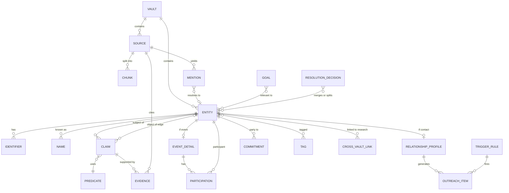

# Personal Graph & Entity Resolution: Conceptual Plan

**Status:** Draft v0.1 · 2026-11-09
**Scope:** Data model, entity resolution, relationship engine, semantic layer, research vault, a simple frontend, and a phased roadmap.

---

## 0. Summary of recommendations

1. **One engine, two vaults.** A *Personal* vault for relationship management and a *Research* vault for long-term investigation share the same code and schema. They live in **separate databases with separate encryption keys**. Data crosses between them only through explicit links that you confirm.
2. **Keep what was observed separate from what is believed.** Raw sources lead to *mentions*, and mentions are resolved into *entities*. A merge is a recorded decision you can undo, never a destructive rewrite. This is what lets entity resolution run over years and keep improving.
3. **Store facts as claims, not columns.** Every fact and every relationship is a statement: subject, predicate, object, plus its source, confidence, valid time and recorded time. This gives you provenance, contradictions, history, "what changed since we last spoke" and "as-of" queries without extra work.
4. **Relational core, graph as a projection.** Use Postgres (with pgvector, full-text search and trigram matching) as the system of record. Run graph analytics on projections built from it. Add a dedicated graph database only if traversal workloads ever need one.
5. **Events drive the CRM side.** Every interaction is an event. Days since contact, cadence, relationship strength, triggers and briefings are all computed from events.
6. **LLMs propose; you or a threshold decide.** Extraction from notes, resolution of ambiguous pairs and profile summaries all arrive as *proposed* claims with provenance. They go to a review inbox, or are auto-accepted above a confidence threshold you set per vault.
7. **Expose the system to agents from day one** through an API and an MCP server. This is where most of the "beyond human capacity" leverage comes from: pre-meeting briefs, watchlist monitoring, introduction matching and weekly reviews across hundreds or thousands of ties, which no person can sustain by hand.

---

## 1. Use cases and scope

| Track | Primary jobs | What success looks like |
|---|---|---|
| **Personal: relationship management** (primary) | Track people and organizations once entered. Log past and upcoming events with notes and tags. Map relationships and facts. Know days since contact and when outreach is due. | You never lose a fact someone told you. The "Today" list tells you who to contact and why. Before any meeting you get a one-screen brief. |
| **Research: network mapping and resolution** (secondary, can run standalone) | Ingest people, organizations, publications, links, filings and historical events. Resolve duplicates across sources over years. Search structured data, full text and meaning together. | A researcher can answer "who is connected to whom, according to which sources, as of when" and can defend every edge with a citation. |
| **Strategic** (spans both) | Goals, warm-introduction paths, bridging ties, matching asks to offers, watchlists. | The system surfaces opportunities a human would not notice across a network larger than the ~150 relationships a person can actively maintain. |

**Not in v1:** multi-user collaboration, scraping social networks against their terms of service, sending messages automatically. (Drafting messages is in scope; sending is not.)

---

## 2. Design principles

1. **Append-only evidence.** Sources are immutable and content-hashed. Everything else can be derived again from them.
2. **Provenance on everything.** Every claim records who or what asserted it (you, an import, a rule, a model and its version) and which source span supports it.
3. **Reversibility.** Merges, splits and claim acceptances are decision records. Undoing one replays from the decision log.
4. **Bitemporal time.** *Valid time* is when something was true in the world. *Recorded time* is when the system learned it. Dates carry a precision (day, month, year, decade or "circa").
5. **Uncertainty is first-class.** Claims have confidence. Contradicting claims sit side by side, flagged instead of overwritten. This matters most in the research vault.
6. **A type system that can grow.** Entity types and predicates live in registries, not hard-coded tables. Adding "Vessel" or "Grant" is a data change, not a migration.
7. **Explainable recommendations.** Every suggestion shows its reason ("94 days since contact; cadence 60; she changed jobs on Oct 3").
8. **Privacy by partition.** Vault boundaries, sensitivity labels on predicates, and nothing leaves the machine unless you choose a provider that requires it.

---

## 3. Architecture in layers


| Layer | Contents | Mutability |
|---|---|---|
| **L0 Evidence** | Notes, emails, calendar items, web snapshots, PDFs, import rows | Immutable (append only) |
| **L1 Extraction** | Text chunks, embeddings, mentions (references to entities found in a source), proposed claims | Regenerated when models change; versioned |
| **L2 Knowledge** | Entities, claims, events, resolution decisions | Append-only claims; decisions can be reversed |
| **L3 Derived** | Golden records, summaries, graph metrics, scores, queues | Recomputed freely |
| **L4 Interfaces** | UI, API, MCP server, exports | Read-mostly; writes go through L2 as proposals or decisions |

---

## 4. Data model

### 4.1 Core concepts

| Concept | What it is | Notes |
|---|---|---|
| **Vault** | An isolated store: `personal` or `research` (you can have several research vaults, one per project or case) | Separate database and key |
| **Source** | Any piece of evidence: note, email, meeting log, URL snapshot, paper, filing, import row, or "manual entry by me" | Content hash, capture time, publish time, reliability rating |
| **Chunk** | A passage of a source's text, with full-text index and embedding | Unit of semantic search |
| **Mention** | A reference to an entity inside a source ("J. Smith, Acme CFO" in note #812) | The unit of entity resolution |
| **Entity** | A resolved real-world thing: person, organization, place, event, document, topic, asset, and so on | Stable ID that is never reused; merged entities redirect |
| **Identifier** | A strong key: email, phone, ORCID, DOI, LEI, Wikidata QID, URL, social handle, company registration number | Normalized; drives deterministic matches |
| **Name** | Every name an entity has had: legal, nickname, former, transliterated, misspelling | Carries valid time |
| **Claim** | A statement: subject, predicate, object or value, plus qualifiers, time, confidence, status and evidence | Both facts *and* relationships are claims |
| **Predicate** | A registry entry defining a property or relationship type: its domain, range, cardinality, inverse, symmetry, whether it is temporal, and its sensitivity | Lets the type system grow |
| **Event** | An entity with time, place, participants with roles, channel, status (planned, occurred, cancelled, missed), notes and tags | Interactions are a kind of event |
| **Tag / Collection** | Namespaced labels (`context:college`, `topic:ai-policy`) and curated sets | Polymorphic: entities, events, sources, claims |
| **Goal** | Something you are pursuing, which entities and claims can be linked to | Drives strategic ranking |
| **Relationship profile** | Personal vault only: *your* relationship to a contact (tier, cadence, closeness, how you met, computed strength) | Centered on you as the ego |
| **Commitment** | An open loop: an ask, an offer or a promise between parties, with a due date | Extracted from notes or entered by hand |
| **Trigger rule / Outreach item** | Rules that create dated to-do items with reasons | Feeds the "Today" queue |
| **Resolution decision** | A merge, split, "not the same" or cross-vault link, with who decided, evidence and time | Can be replayed and undone |

### 4.2 Entity types and engagement levels

**Base types:** `Person`, `Organization`, `Place`, `Event`, `Document` (paper, article, filing, web page), `Topic`, `Asset` (domain, vehicle, property, account), plus types you add. Each type has a JSON Schema in the type registry for type-specific attributes. Types can inherit (`Interaction` is an `Event`; `Paper` is a `Document`).

**Engagement level** (personal vault) is what keeps the personal network dense without turning it into a cluttered address book:

| Level | Meaning | Gets a relationship profile and cadence? |
|---|---|---|
| `ego` | You | n/a |
| `contact` | Someone you actively maintain a relationship with | Yes |
| `acquaintance` | Someone you have met but do not actively track | Optional (no cadence) |
| `reference` | Known *of*: a company, a school, a friend's spouse you have not met, a public figure | No |

Reference nodes are what connect your contacts to each other. Two contacts who both list "Stanford 2012" or "Acme (2018–2021)" become linked through a shared node, so the graph gets denser and more useful without you entering every pairwise edge.

### 4.3 Claims: facts and relationships in one shape

A claim follows the Wikidata model of statement, qualifiers and references:

```
claim:
  subject:      entity(Sarah Chen)
  predicate:    employed_by
  object:       entity(Stripe)            # an edge; for an attribute use value: {...}
  qualifiers:   { title: "Head of Payments Partnerships", team: "Partnerships" }
  valid_from:   2021-03     (precision: month)
  valid_to:     2027-01     (precision: month, status: expected)
  confidence:   0.9
  status:       accepted    # proposed | accepted | rejected | disputed | superseded
  evidence:     [ source#812 span 120-188 ]
  asserted_by:  model:extractor@v3, confirmed by: me
  recorded_at:  2026-11-09T14:02Z
  superseded_by: null
```

- **Edges are claims whose object is an entity.** `knows`, `employed_by`, `parent_of`, `co_authored_with`, `funded_by`, `introduced_by`, `member_of`, `located_in`, `owns`, `cites`, and so on.
- **Attributes are claims whose object is a value** (birthday, title, city, interests, dietary preference).
- **The predicate registry defines behavior:** `parent_of` is the inverse of `child_of`; `knows` is symmetric; `birth_date` has single cardinality; `employed_by` is temporal and can hold many values; `health_condition` is labeled `sensitive`.
- **Corrections never overwrite.** A new claim supersedes the old one, and the old one keeps its recorded time. This is how "what changed since I last spoke to X" works: a diff of claims by recorded time.

### 4.4 Events

```
event (an entity of type Event):
  kind:           meeting | call | message | email | meal | conference | life_event
                  | publication | transaction | incident | ...
  status:         planned | occurred | cancelled | missed
  start / end:    timestamp or fuzzy date (precision)
  location:       entity(Place) or a free-text value
  channel:        in_person | video | call | message | email | social
  initiated_by:   entity          # used for reciprocity
  counts_as_contact: bool          # e.g. false for "saw her at a 500-person conference"
  participants:   [ {entity, role: host | attendee | speaker | subject | mentioned} ]
  notes_md:       free text (also stored as a Source, so it is chunked, embedded and extracted)
  tags:           [ ... ]
  follow_ups:     [ commitment ... ]
```

Historical events (a 2014 board meeting, a 1998 merger) and future ones (next Thursday's dinner) use the same shape. Only `status` and the dates differ.

### 4.5 Time

- **Valid time:** `valid_from` and `valid_to` on claims; `start` and `end` on events.
- **Recorded time:** `recorded_at` and `superseded_at` on claims.
- **Precision:** `instant | day | month | quarter | year | decade | circa`, plus optional bounds (`earliest`, `latest`). This handles "early 2019" and "late 1990s" without inventing false precision.

Two kinds of query follow from this:
- *Valid time:* "Show Sarah's employers in 2019." "Show the board of Org X as it was in 2008."
- *Recorded time:* "What did I believe about Org X on 2025-03-01?" This matters for research audit trails and for "since we last spoke" diffs.

### 4.6 Provenance and reliability

- **Source reliability** (research vault) uses the Admiralty grading: source reliability **A–F** and information credibility **1–6**. A claim's effective confidence combines model or user confidence with source grade and corroboration (the number of independent sources).
- **Corroboration:** many evidence rows can attach to one claim. Independence is tracked so that ten articles all copying one wire story do not count as ten sources.
- **Snapshots:** web sources store a fetched copy (HTML or PDF), its hash, the capture time and an archive URL where available, so citations survive link rot.

### 4.7 Tags, collections and goals

- **Tags** use namespaces (`context:`, `topic:`, `project:`, `circle:`) and can nest. They apply to entities, events, sources and claims.
- **Collections** are curated sets (a "Climate investors" list, or a set of entities in a case).
- **Goals** ("raise a seed round by Q2", "move into AI policy", "finish book research") link to entities, tags and topics with a relevance weight. Recommendations rank higher when they advance an active goal.

### 4.8 The relationship layer (personal vault only)

```
relationship_profile (one per contact):
  tier:                inner | close | active | extended | wider     # Dunbar-style layers
  cadence_days:        explicit override, else the tier default, else a learned value
  closeness_self:      1-5 (your own rating)
  how_met:             event or free text
  introduced_by:       entity
  contexts:            [tags]                      # the number of contexts is "multiplexity"
  # derived (L3):
  last_contact_at, days_since_contact, next_due_at, strength, reciprocity, trend
```

### 4.9 Entity-relationship diagram



A SQL sketch is in [Appendix A](#appendix-a-schema-sketch-postgres).

---

## 5. Entity resolution (ER)

ER is a long-running process, not a one-time cleanup. The model treats **mentions** as the atoms of evidence and **entities** as clusters of mentions. The clusters can be revised whenever new evidence arrives.

### 5.1 Pipeline

```
new source ──► extract mentions ──► normalize ──► block ──► score pairs ──► cluster ──► decide
                                                                 │                    │
                                                    deterministic rules         auto-accept ≥ t_hi
                                                    probabilistic model         review queue between
                                                    LLM adjudication            auto-reject ≤ t_lo
```

1. **Normalize.** Unicode folding and transliteration. Name parsing (given name, family name, suffixes, honorifics). Nickname tables (Bob = Robert). Phonetic keys (Double Metaphone). Phones in E.164 format. Lowercased email with Gmail dots and plus-tags handled. Canonical URLs. Organization suffix stripping (Inc, LLC, GmbH).
2. **Block.** Generate cheap candidate pairs so comparisons do not grow as n²: exact identifier hash, phonetic family name plus first initial, organization token sets, and approximate-nearest-neighbor search over mention embeddings.
3. **Score.**
   - *Deterministic:* a shared strong identifier (email, ORCID, LEI, DOI author slot, Wikidata QID) means a match unless a cannot-link rule says otherwise.
   - *Probabilistic:* a Fellegi–Sunter style model with per-field match weights (name similarity, date of birth, location, employer overlap, title). It learns weights from your past decisions. For research-scale batch linkage, **Splink** is a mature open-source implementation.
   - *Relational:* shared neighbors. Two "J. Smith" mentions that both co-authored with the same three people are probably one person. This is the main advantage of doing ER inside a graph.
   - *Contextual:* embedding similarity of the surrounding text.
   - *LLM adjudication:* for the uncertain middle band only. Present both profiles with their evidence and record the model's rationale in the decision.
4. **Cluster.** Connected components subject to **must-link** and **cannot-link** constraints. Correlation clustering at research scale. A single weak link must never chain two large clusters together; cap transitive merges and require cluster-level coherence.
5. **Decide.** Thresholds are set per vault. The personal vault is conservative: anything ambiguous goes to review, since there are few records and mistakes are embarrassing. The research vault auto-accepts at a higher threshold and keeps everything reviewable.

### 5.2 Decisions, merges and splits

- A **merge** marks the losing entity `merged_into = winner`. Its ID still resolves (a redirect), and all claims, mentions and edges remain attached to their original records. Views read them through the redirect.
- A **split** reassigns selected mentions and claims to a new entity. Because claims kept their evidence, nothing is lost.
- A **"not the same" decision** creates a persistent cannot-link, so the pair never comes back as a candidate.
- **Your decisions always override model decisions.** When the model is retrained or re-run it cannot undo them.
- Each decision stores the model version, features, score and rationale, which gives a full audit trail for research use.

### 5.3 Golden record (survivorship)

The profile you see is a **computed view**, not stored truth. For each predicate it applies survivorship rules: your manual entries win, then the most reliable source, then the most recent valid claim, then the most corroborated one. Single-valued predicates show the winner and a "2 other values" hint. Disputed values are shown as disputed.

### 5.4 Identity over time

Do **not** merge things that are related but distinct:
- Organizations that rename, merge, are acquired or spin off: use `renamed_to`, `acquired_by`, `successor_of` and `spun_out_of` edges, all with valid time.
- People change names, roles and places. Those are temporal claims on one entity, not new entities.
- Roles versus persons: "the CFO of Acme" is a role that different people held at different times. Model the role as a claim with valid time, so "who was CFO in 2017" can be answered.

### 5.5 Across vaults

The vaults never merge automatically. A **cross-vault link** connects a personal entity to a research entity (for example, a colleague you know personally who also appears in your research corpus). The link is proposed by matching identifiers or names and **confirmed by you**. Through the link, the personal profile can show *read-only* research facts. Personal data never flows into the research vault.

---

## 6. Relationship engine: contact tracking, cadence, triggers and recommendations

### 6.1 Core quantities

```
last_contact_at(c) = max(event.start) over events where
                       status = occurred AND counts_as_contact
                       AND ego ∈ participants AND c ∈ participants

days_since(c)      = today − last_contact_at(c)

cadence(c)         = explicit override
                   ?? tier default        (inner 14 · close 30 · active 60 · extended 120 · wider 365)
                   ?? learned cadence     (median gap between past contacts × 1.15)

next_due(c)        = last_contact_at(c) + cadence(c)
days_to_due(c)     = next_due(c) − today         (negative means overdue)

next_scheduled(c)  = min(event.start) over planned events with c
```

**Suppression:** if a planned event with that person falls before or near `next_due`, do not raise an outreach item. Show "covered by Dinner on Nov 20" instead.

**Drift detection:** if the learned cadence differs from the configured one by more than 50% for more than two cycles, suggest changing the tier ("You've effectively moved Sam from *close* to *extended*. Keep it that way, or reconnect?").

### 6.2 Relationship strength (explainable, not a black box)

```
interaction_score(c) = Σ_events  w_channel × 2^(−age_days / H)          H = 90 days
    w_channel: in_person 1.0 · video 0.8 · call 0.7 · message 0.3 · email 0.3 · social 0.05

strength(c) = 0.5 × norm(interaction_score)
            + 0.3 × closeness_self / 5
            + 0.1 × norm(multiplexity)            # number of distinct contexts
            + 0.1 × reciprocity_health            # 1 − |0.5 − share_initiated_by_them| × 2
```

These weights are starting points that you can tune. The UI should always show the breakdown. Flag one-sided relationships, where you initiate more than 80% of contact, or where they do.

### 6.3 Triggers

| Trigger family | Examples | Creates |
|---|---|---|
| **Cadence** | Overdue against cadence; dormant tie (more than 2× cadence) with high strategic value | Outreach item |
| **Calendar offset** | 3 days before a planned meeting, generate a brief. 1 day after, prompt to log notes and follow-ups. | Brief or log prompt |
| **Recurring dates** | Birthdays, work anniversaries, memorials, the anniversary of when you met | Outreach item with a suggested message |
| **Fact change** | A new job, move, publication, funding round or award, from your notes, imports or watchlist monitoring | "Congratulate or check in" item |
| **Commitments** | A promise is due (you said you would intro Sarah to Raj by Friday); an ask from them is still open | Task |
| **Graph** | A new mutual connection; two contacts whose asks and offers match; a contact who just joined an organization tied to an active goal | Intro suggestion |
| **Research watchlist** | A watched entity appears in a newly ingested source; a new co-author; a new filing | Alert in the research inbox |

Each rule is a row in `trigger_rule` (scope: global, tag or entity; kind; parameters; active). This makes rules editable data rather than code.

### 6.4 The "Today" ranking

```
priority = urgency × importance + explicit_boost

urgency     = clamp(days_since / cadence, 0, 3)        # surfaced from about 0.9
importance  = 0.4 × tier_weight + 0.3 × strength + 0.3 × goal_relevance
explicit_boost: due commitments, dated triggers, pre-meeting briefs
```

Every row shows **why** it is there and offers one action: *log contact*, *snooze* (with a reason), *draft message*, *schedule* or *dismiss*. Snoozes and dismissals feed back into learned cadence.

---

## 7. Semantic layer: notes and events at scale

Every note, event description, email body you choose to store, and research document passes through the same pipeline:

1. **Chunk** into passages of about 200–500 tokens, keeping speaker and section metadata.
2. **Index:** full-text search (BM25 or Postgres `tsvector`) plus an embedding (pgvector). Store the embedding model ID with every vector so you can re-embed when you change models.
3. **Extract** with an LLM into structured form: mentions, proposed claims, events, commitments, topics, sentiment and dates. Everything links back to the source span.
4. **Derive** analyses on demand or on a schedule:
   - Topic trends per person, circle or period ("what do I talk about with X", "how has Y's focus shifted").
   - Sentiment or energy trajectory per relationship. Use this carefully and show it only to you.
   - Expertise mapping, so "who in my network knows about grid-scale storage?" draws on topics from notes, claims and publications.
   - Clustering of events and themes across thousands of notes.
5. **Retrieval for questions:** hybrid search (keyword plus vector plus structured filters) combined with **graph expansion**. Retrieve the relevant subgraph (entities, claims, recent events) and the supporting chunks, then answer with citations to sources. This is often called GraphRAG.

Example queries the layer should support:
- "Contacts I haven't spoken to in 6+ months who know about grid storage and are in Denver."
- "Every time someone mentioned they were hiring in the last year."
- "Papers since 2020 that cite both A and B, and the institutions their authors share."

---

## 8. Research vault specifics

The research vault runs the same engine with stricter provenance and features for scale.

- **Projects and cases** scope sources, entities and hypotheses. A vault can hold many projects, and entities are shared across projects within the vault.
- **Source library:** papers (DOI and author list), articles, filings, court records, datasets, archived web pages, interviews and your own field notes. Each has a reliability grade, a snapshot and a hash.
- **Bulk ingest connectors**, used where licensing permits: OpenAlex and Crossref (publications), ORCID (researchers), ROR (institutions), Wikidata (general entities), GLEIF and OpenCorporates (companies), SEC EDGAR and other registries (filings), plus CSV or JSON uploads with a column-mapping step.
- **External IDs as anchors:** ORCID, ROR, DOI, LEI, Wikidata QID and registry numbers are high-confidence identifiers for ER and allow later enrichment.
- **Interoperability:** align the type and predicate registry with the **Follow the Money (FtM)** schema used by investigative tools (OpenSanctions, Aleph) and with Wikidata properties, so data can move in and out. Exports: GraphML or GEXF (for Gephi), CSV, JSON-LD and FtM.
- **Analytic features:**
  - Timeline and **as-of** views: a time slider on the graph, and both kinds of time from section 4.5.
  - **Hypotheses:** an Analysis of Competing Hypotheses matrix that links evidence (claims and sources) to hypotheses as consistent, inconsistent or neutral.
  - Contradiction finder: claims that conflict on single-valued predicates or overlapping time.
  - Network analytics: centrality, communities, brokers (betweenness), shortest and k-shortest paths, ego networks, and co-occurrence networks built from mentions.
  - Watchlists: re-run ER and alerting when new sources mention watched entities.
- **Running standalone:** the research vault does not need a personal vault. Packaged alone, it is a general network-mapping and resolution tool for researchers.

---

## 9. Frontend

Keep it straightforward. These are eight views, built in priority order.

### 9.1 Today (home)

```
┌ Today ─────────────────────────────────────────────── Review inbox (7) ┐
│ DUE / OVERDUE                                                           │
│  ● Sarah Chen   · 41d since · cadence 30 · changed jobs (Oct)   [Log][Draft][Snooze] │
│  ● Dev Patel    · 130d · dormant, bridges you to climate investors     │
│ UPCOMING (14 days)                                                      │
│  Thu  Dinner w/ Raj & Mia              brief ready ▸                    │
│  Sat  Alex's birthday                  suggested note ▸                 │
│ OPEN LOOPS                                                              │
│  You → Sarah: intro to Raj (due Fri)                                    │
│ SINCE LAST WEEK                                                         │
│  3 fact changes in your network · 2 new mutual connections              │
└─────────────────────────────────────────────────────────────────────────┘
```

### 9.2 Entity profile

```
┌ Sarah Chen ─ contact · tier: close · cadence 30d ─ last: 41d ago ─ next: overdue 11d ┐
│ MEMORY (auto-summary, each line cited)                                      │
│  Partnerships lead at Stripe → joining a climate startup in Jan. Daughter   │
│  starting at U. Michigan in fall 2027. Interested in grid storage.          │
│ CHANGED SINCE LAST CONTACT: new role (Oct 3) · moved to Oakland             │
├ Facts ───────────────┬ Relationships ─────────────┬ Timeline ───────────────┤
│ employer, title, city │ mini ego-graph (1–2 hops) │ events, notes, changes │
│ (source and confidence │ knows Raj · ex-colleague  │ filter by tag or kind  │
│  on hover; history)    │ of Dev · introduced by Mia│                        │
├ Open loops ─ Tags ─ Goals ─ Linked research entity ─────────────────────────┤
└─────────────────────────────────────────────────────────────────────────────┘
```

### 9.3 Remaining views

3. **Capture:** a single text box ("Coffee with Sarah today, she's leaving Stripe...") that is parsed into a preview of the event, claims and follow-ups for you to confirm. Also plain forms for entity, event and relationship.
4. **Timeline and calendar:** past and planned events, filterable by person, tag or kind.
5. **Graph explorer:** ego network or project graph, filtered by type, tag, tier and time slider. Color by community. Includes a path finder ("warm path to X") and side-panel details.
6. **Search:** one box combining keyword, semantic and structured filters, with facets.
7. **Review inbox:** merge candidates side by side with evidence, proposed claims from extraction, contradictions, and cross-vault link proposals. Keyboard-driven accept or reject.
8. **Research workspace:** projects, source library, entity tables (a spreadsheet-like grid), timeline, graph, hypotheses board and exports.

**Graph rendering:** Cytoscape.js for ego and small graphs (under about 5,000 elements). Sigma.js with graphology (WebGL) for large research graphs.

---

## 10. Strategic recommendations: going beyond human capacity

The constraint being lifted is the cognitive limit: roughly 150 maintained relationships, imperfect recall, and no capacity for continuous monitoring. The system should do the following.

1. **Perfect memory with context.** Every fact is recalled with its source, and the "changed since last contact" diff is computed automatically. Pre-meeting briefs combine recent events, open loops, new facts, shared connections and suggested topics.
2. **Maintain weak ties at scale.** Weak ties are where new information and opportunities come from (Granovetter). Light-touch cadences for the extended and wider tiers, with suggested low-effort touches (sharing an article that matches their topics, congratulations on a fact change), keep hundreds of ties warm.
3. **Find structural holes and brokerage.** Identify contacts who bridge otherwise separate clusters (Burt), and contacts whose introduction to each other would create value. Rank by goal relevance.
4. **Warm-introduction paths.** Weighted shortest paths where an edge's cost is `−log(strength)`, so the strongest chain wins. Show the top three paths with the person you would ask at each hop.
5. **Asks and offers matching.** Track what people need (hiring, raising, looking for a doctor, moving to Berlin) and what they offer (expertise, roles, introductions). Matching runs continuously and surfaces pairs.
6. **Reciprocity awareness.** A lightweight record of favors given and received, used only for your own balance and never exposed. It helps you notice one-sided relationships in either direction.
7. **Monitoring as an agent task.** Agents watch public sources (publications, company news, filings) for watchlisted entities and *propose* claims. You review them in the inbox.
8. **Weekly review ritual.** An agent compiles the week: who you saw, loops closed and opened, ties decaying, opportunities, and goal progress. It drafts the next week's outreach.
9. **Ask the network questions.** "Who could help with X?" is answered from topics, claims, publications and paths, not just from tags.
10. **Agent interface.** An MCP server exposing tools such as `search`, `get_profile`, `log_event`, `propose_claim`, `due_outreach`, `find_paths`, `brief(entity)` and `research_query`. Agents can read but write **only proposals**, and every agent write is attributed and reversible.

---

## 11. Technology recommendations

| Concern | Recommendation | Why |
|---|---|---|
| System of record | **PostgreSQL 16+** with `pgvector`, `pg_trgm`, `fuzzystrmatch` and built-in full-text search | One engine for relational data, text, vectors and recursive graph queries; strong constraints and auditability |
| Vault isolation | A separate database per vault, each with its own key (disk or column encryption) | Clean privacy boundary; the research vault can be shipped standalone |
| Graph analytics | Nightly or on-demand projection into **igraph** or **NetworkX** (Python) for centrality, communities and paths. Add Neo4j or another graph DB only if interactive deep traversals become a bottleneck. | Keeps a single source of truth |
| Batch ER | **Splink** (probabilistic linkage on DuckDB) for research-scale jobs, plus custom incremental matching for live entry | Proven, explainable match weights |
| Backend | **Python + FastAPI**, with background workers for extraction, ER, scoring and triggers (a simple Postgres-backed job queue at first) | Matches your existing Python work and the data and ML ecosystem |
| Frontend | **React (Vite) or SvelteKit**, Cytoscape.js and Sigma.js for graphs, vis-timeline for timelines | Simple and well supported |
| LLM / embeddings | Pluggable provider. A hosted model for quality, with the option of a local model for sensitive personal notes. Store the model ID with every output. | Swappable; privacy control |
| Analytics and export | DuckDB over Parquet exports for heavy semantic or statistical analysis | Fast local analysis at scale |
| Deployment | Docker Compose locally (local-first). Hosted later if needed. | Personal data stays on your machine by default |

**Alternative for maximum portability:** SQLite with FTS5, sqlite-vec and SQLCipher, giving one encrypted file per vault. This works well for the personal vault but scales less well for research. If you choose it, keep the schema identical so a vault can be promoted to Postgres later.

---

## 12. Privacy, security and ethics

- The data concerns **third parties** who did not opt in. Default to local-first storage, encryption at rest, and no telemetry.
- Sensitivity labels on predicates (health, family, finances, politics, religion) control where data is shown, whether it is sent to remote LLMs, and whether it can be exported.
- An append-only audit log of reads by agents and of all writes.
- Research use: respect source licenses and terms of service; record collection method and legal basis; support redaction and deletion of entities and their derived data. Deletion is the one exception to append-only, and it is done as a crypto-shred of the blobs plus tombstones.
- Recommendation features (reciprocity, sentiment) stay private to you and are never written into anything you might export or share.

---

## 13. Roadmap

| Phase | Deliverable | Contents |
|---|---|---|
| **0: Foundation** | Personal MVP | Schema (vaults, sources, entities, identifiers, names, claims, events, participation, tags, relationship profiles); manual entry forms; profile page; Today view with days since contact, cadence and next due; timeline |
| **1: Capture and memory** | Notes become structure | Natural-language quick capture with LLM extraction into proposed claims; review inbox; chunking, full-text search and embeddings; hybrid search; auto-generated "memory" summaries; "changed since last contact" |
| **2: ER and triggers** | Clean data at scale | Deterministic and probabilistic matching; merge, split and not-the-same decisions with undo; imports (contacts, calendar, LinkedIn CSV); trigger engine (dates, calendar offsets, fact changes, commitments); pre-meeting briefs; graph explorer |
| **3: Research vault** | Standalone research tool | Projects; source library with snapshots and reliability grades; bulk connectors; Splink batch ER; as-of queries; contradictions; hypotheses matrix; FtM, GraphML and CSV export; large-graph view |
| **4: Strategic and agentic** | Leverage beyond human capacity | MCP server; watchlist monitoring; goals; warm paths; brokerage and introduction suggestions; asks and offers matching; weekly review agent; topic and expertise analytics |

**Suggested first build slice (about two weeks of evenings):** Phase 0 plus the quick-capture text box, with extraction stubbed by a simple form. This gets the daily loop (log interaction, see who is due) working before any ML, and starts producing the data the later layers need.

---

## 14. Open decisions for you

1. **Local-first or hosted?** This affects encryption, sync across devices and LLM choice. (Recommendation: local-first, with optional encrypted sync later.)
2. **Single user only, or will research vaults be shared with collaborators?** Sharing adds permissions and per-user provenance; the schema already supports the latter.
3. **Which data sources first?** Calendar and contacts give the most value for the least effort. Email bodies give the richest data but carry the highest privacy cost; metadata only is a reasonable middle ground.
4. **LLM provider policy for personal notes:** hosted, local, or hosted with the `sensitive` predicates redacted.
5. **Research domain:** academic networks, corporate or financial investigations, historical, or OSINT. This decides which connectors and type packs (for example FtM) to build first.

---

## Appendix A: Schema sketch (Postgres)

Illustrative only. Names and types will change during implementation.

```sql
-- ── Registries ─────────────────────────────────────────────────────────────
create table entity_type (
  id text primary key,                 -- 'person', 'organization', 'event', ...
  parent_id text references entity_type(id),
  attr_schema jsonb not null default '{}'   -- JSON Schema for type-specific attributes
);

create table predicate (
  id text primary key,                 -- 'employed_by', 'birth_date', 'knows', ...
  label text not null,
  domain_types text[] not null,        -- allowed subject types
  range_kind text not null,            -- 'entity' | 'string' | 'date' | 'number' | 'json'
  range_types text[],                  -- allowed object types when range_kind = 'entity'
  cardinality text not null default 'many',  -- 'one' | 'many'
  temporal boolean not null default true,
  symmetric boolean not null default false,
  inverse_id text references predicate(id),
  sensitivity text not null default 'normal' -- 'normal' | 'sensitive' | 'restricted'
);

-- ── Evidence (L0/L1) ───────────────────────────────────────────────────────
create table source (
  id uuid primary key,
  kind text not null,                  -- note | email | calendar | web | paper | filing | import | manual
  uri text,
  title text,
  content_hash text not null,
  blob_ref text,                       -- pointer to stored original
  captured_at timestamptz not null default now(),
  published_at timestamptz,
  reliability char(1),                 -- Admiralty A–F (research)
  credibility smallint,                -- Admiralty 1–6 (research)
  metadata jsonb not null default '{}'
);

create table chunk (
  id uuid primary key,
  source_id uuid not null references source(id),
  ordinal int not null,
  text text not null,
  tsv tsvector generated always as (to_tsvector('english', text)) stored,
  embedding vector(1024),
  embedding_model text
);

create table mention (
  id uuid primary key,
  source_id uuid not null references source(id),
  chunk_id uuid references chunk(id),
  span int4range,
  surface text not null,
  type_guess text references entity_type(id),
  features jsonb not null default '{}',   -- normalized name parts, phonetic keys, context
  entity_id uuid,                          -- current resolution (nullable)
  resolution_score real
);

-- ── Knowledge (L2) ─────────────────────────────────────────────────────────
create table entity (
  id uuid primary key,
  type_id text not null references entity_type(id),
  display_name text not null,
  status text not null default 'active',   -- active | merged | archived | deleted
  merged_into uuid references entity(id),
  engagement text,                          -- ego | contact | acquaintance | reference (personal)
  attrs jsonb not null default '{}',
  created_at timestamptz not null default now()
);

create table identifier (
  entity_id uuid not null references entity(id),
  scheme text not null,                     -- email | phone | orcid | doi | lei | wikidata | url | handle
  value text not null,                      -- normalized
  verified boolean not null default false,
  source_id uuid references source(id),
  primary key (scheme, value, entity_id)
);

create table entity_name (
  entity_id uuid not null references entity(id),
  name text not null,
  kind text not null default 'primary',     -- primary | legal | nickname | former | transliteration
  valid_from date, valid_to date
);

create table claim (
  id uuid primary key,
  subject_id uuid not null references entity(id),
  predicate_id text not null references predicate(id),
  object_id uuid references entity(id),     -- set for edges
  value jsonb,                              -- set for attributes
  qualifiers jsonb not null default '{}',
  valid_from date, valid_to date,
  time_precision text,                      -- day | month | year | decade | circa
  confidence real not null default 1.0,
  status text not null default 'proposed',  -- proposed | accepted | rejected | disputed | superseded
  asserted_by text not null,                -- 'user' | 'import:<name>' | 'rule:<id>' | 'model:<id>@<ver>'
  recorded_at timestamptz not null default now(),
  superseded_by uuid references claim(id),
  check ((object_id is null) <> (value is null))
);

create table claim_evidence (
  claim_id uuid not null references claim(id),
  source_id uuid not null references source(id),
  span int4range,
  note text,
  primary key (claim_id, source_id)
);

create table event_detail (
  entity_id uuid primary key references entity(id),
  kind text not null,
  status text not null,                     -- planned | occurred | cancelled | missed
  start_at timestamptz, end_at timestamptz,
  time_precision text,
  location_id uuid references entity(id),
  channel text,
  initiated_by uuid references entity(id),
  counts_as_contact boolean not null default true,
  notes_source_id uuid references source(id)
);

create table participation (
  event_id uuid not null references entity(id),
  entity_id uuid not null references entity(id),
  role text not null default 'attendee',
  primary key (event_id, entity_id, role)
);

create table tag (id uuid primary key, namespace text, name text not null, parent_id uuid references tag(id));
create table tagging (tag_id uuid references tag(id), target_kind text, target_id uuid,
                      primary key (tag_id, target_kind, target_id));

-- ── Personal relationship layer ────────────────────────────────────────────
create table relationship_profile (
  entity_id uuid primary key references entity(id),
  tier text not null default 'active',
  cadence_days int,                         -- override; null means use tier default or learned value
  closeness_self smallint,
  how_met_event_id uuid references entity(id),
  introduced_by uuid references entity(id)
);

create table commitment (
  id uuid primary key,
  from_id uuid references entity(id),
  to_id uuid references entity(id),
  kind text not null,                       -- promise | ask | offer
  description text not null,
  due_at date,
  status text not null default 'open',
  source_event_id uuid references entity(id)
);

create table trigger_rule (id uuid primary key, scope jsonb, kind text, params jsonb, active boolean default true);

create table outreach_item (
  id uuid primary key,
  entity_id uuid not null references entity(id),
  rule_id uuid references trigger_rule(id),
  due_at date not null,
  reason text not null,                     -- shown to you as-is
  status text not null default 'open',      -- open | done | snoozed | dismissed
  resolved_by_event_id uuid references entity(id)
);

create table goal (id uuid primary key, title text, description text, horizon date, active boolean default true);
create table goal_link (goal_id uuid references goal(id), target_kind text, target_id uuid, relevance real,
                        primary key (goal_id, target_kind, target_id));

-- ── Resolution and cross-vault ─────────────────────────────────────────────
create table resolution_decision (
  id uuid primary key,
  kind text not null,                       -- merge | split | not_same | link_mention | cross_vault_link
  payload jsonb not null,                   -- entity and mention IDs involved
  decided_by text not null,                 -- user | rule:<id> | model:<id>@<ver>
  score real,
  features jsonb,
  rationale text,
  decided_at timestamptz not null default now(),
  reverted_by uuid references resolution_decision(id)
);

create table cross_vault_link (
  personal_entity_id uuid not null references entity(id),
  research_vault text not null,
  research_entity_id uuid not null,         -- foreign ID in the other database
  confirmed_at timestamptz,
  primary key (personal_entity_id, research_vault, research_entity_id)
);

-- ── Derived (L3), recomputed ───────────────────────────────────────────────
create view contact_status as
select rp.entity_id,
       max(ed.start_at) filter (where ed.status = 'occurred' and ed.counts_as_contact) as last_contact_at,
       min(ed.start_at) filter (where ed.status = 'planned' and ed.start_at > now())   as next_scheduled_at
from relationship_profile rp
left join participation p on p.entity_id = rp.entity_id
left join event_detail ed on ed.entity_id = p.event_id
group by rp.entity_id;
-- days_since, cadence resolution, next_due and strength are computed in the scoring job
```

---

## Appendix B: Walk-through, from one quick capture to stored records

**Input (Today box):**
> Coffee w/ Sarah Chen at Blue Bottle this morning. She's leaving Stripe in Jan for a climate-tech startup (Series A). Daughter starting at Michigan next fall. Promised to intro her to Raj. Follow up in 3 weeks.

**What gets written:**

| Record | Content | Status |
|---|---|---|
| `source` | The raw note, hashed | stored |
| `event` | kind `meeting`, channel `in_person`, status `occurred`, today; participants: you and Sarah; location: Blue Bottle (place entity created as `reference`) | accepted (you confirmed the capture) |
| `mention` "Sarah Chen" | Matched to existing entity E-123 on name plus the employer claim (Stripe), score 0.97 | auto-linked |
| `mention` "Raj" | Two candidates (Raj Mehta, Raj Iyer) | **review inbox** |
| `mention` "Michigan" | Resolved to University of Michigan (organization, `reference`) | proposed |
| `claim` | Sarah `employed_by` Stripe, `valid_to` 2027-01 (month, expected) | proposed |
| `claim` | Sarah `employed_by` *[unnamed climate-tech startup]* from 2027-01; qualifier `stage: Series A` | proposed (placeholder entity, resolved later) |
| `claim` | Sarah `parent_of` *[daughter]*; daughter `attends` U. Michigan from 2027-09 (season precision) | proposed, `sensitive: family` |
| `commitment` | You promise Sarah an intro to Raj, due in about 7 days | open |
| `outreach_item` | Sarah, due today + 21 days, reason "explicit follow-up from coffee on Nov 9" | open |
| `trigger` | Fact-change watch: Sarah's new role starts around January, so suggest congratulations | scheduled |
| L3 recompute | Sarah's `last_contact_at` is today, strength is updated, and the memory summary is regenerated with citations | derived |

Next time you open Sarah's profile, the summary already says she is moving to a climate startup in January and that you owe her an intro to Raj. On about January 5 the Today view will suggest a congratulations note.
